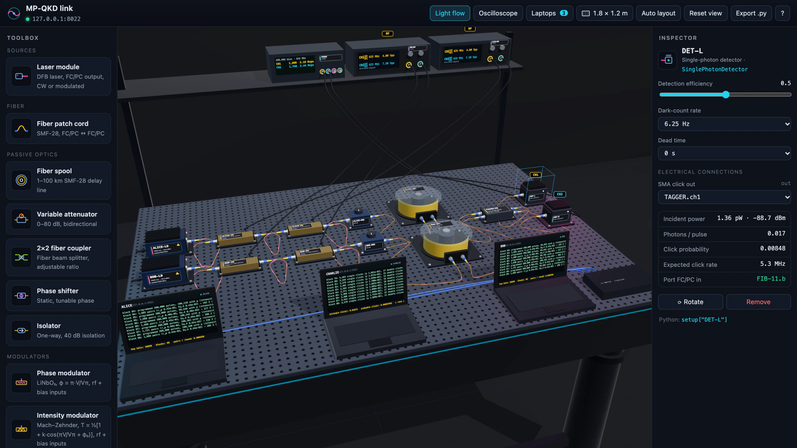

# phoq

[](https://github.com/ammar-faifi/phoq/actions/workflows/ci.yml)
[](https://pypi.org/project/phoq/)

**phoq** (photon + q, it sounds like Fock) is a quantum optics and quantum-communication lab for Python. Build fiber-optic experiments from parts — lasers, modulators, couplers, attenuators, photodiodes, single-photon
detectors, arbitrary waveform generators, time taggers, oscilloscopes — run them, post-process the clicks
with your own scripts, and run multi-party protocols such as QKD with every party in its own
process talking over real sockets. A 3D virtual lab in the browser shows the same Python objects
live and lets you edit them.

The details are in three more READMEs: [docs/README.md](docs/README.md) for the engine
(components, connectors, the command line, analysis scripts, the parties framework, the
physics model and the theory of each instrument), [examples/README.md](examples/README.md) for
the examples and the QKD protocols, and [src/phoq/presets/README.md](src/phoq/presets/README.md)
for the part presets.



*The virtual lab serving MP-QKD (`phoq serve --protocol mpqkd`): Alice's and Bob's transmitters,
Charlie's detectors, the instrument shelf and a laptop per party.*


*`examples/modulated_link.py`: the scope shows the photocurrent (CH1) next to the generator's
10 MHz drive (CH2).*


*Alice's console: each block's pairs and sifted bits, and her traffic with Charlie and Bob
(taken before error correction and privacy amplification were added).*

## Quick start

```bash
pip install phoq
```

`pip install "phoq[plot]"` adds matplotlib for the plotting helpers. Python 3.14 or newer.
Inside this repository, `uv sync` installs everything and commands are run with `uv run …`.

```python
from phoq import Setup, Laser, Fiber, Photodiode, Oscilloscope

laser = Laser(power_dbm=-7, mode="pulsed", rep_rate=10e6, pulse_width=5e-9)
setup = Setup.from_chain(laser, Fiber(length=2), Photodiode(bandwidth=1e9), Oscilloscope(timebase=20e-9))

print(setup.run().summary())     # OSC-1: ch1 ← PD-1: mean 163 µA, pk-pk 2.99 mA, f 10 MHz
laser.power_dbm = 0              # parameters are plain, validated attributes
setup.serve()                    # optional: http://127.0.0.1:8000 shows it live in 3D
```

```bash
phoq run examples/delay_line.py              # headless
```

```bash
phoq serve examples/basic_link.py            # the virtual lab at http://127.0.0.1:8000
```

```bash
phoq serve --protocol examples/mpqkd         # MP-QKD: Alice, Bob and Charlie as processes
```

```bash
phoq run --protocol bb84 --party examples/bb84/eve.py   # decoy-state BB84 with an eavesdropper
```

[docs/README.md](docs/README.md#command-line) explains every command and option.

## Examples

Each runs headless with `phoq run` and opens in the virtual lab with `phoq serve`;
[examples/README.md](examples/README.md) has the details.

QKD protocols, each a directory with its parties and a README:

- [examples/mpqkd](examples/mpqkd/README.md): mode-pairing QKD with Alice, Bob and Charlie,
  from the clicks to a secret key.
- [examples/bb84](examples/bb84/README.md): phase-coding BB84 with decoy states, and an
  intercept-resend eavesdropper.
- [examples/cow](examples/cow/README.md): coherent one-way QKD up to the sifted key, and an
  attack in the time basis.
- [examples/cow_vacuum](examples/cow_vacuum/README.md): COW with a vacuum decoy sequence, up
  to the bound on the phase error rate.

Benches and measurements:

- [basic_link.py](examples/basic_link.py): laser, patch cord, photodiode and oscilloscope.
- [delay_line.py](examples/delay_line.py): a pulse train split in two, one arm through a 1 km
  spool.
- [modulated_link.py](examples/modulated_link.py): an intensity modulator at quadrature, driven
  by the generator's sine.
- [connector_cascade.py](examples/connector_cascade.py): patch cords through mating sleeves, and
  what each mating costs.
- [mzi_interference.py](examples/mzi_interference.py): a fiber Mach–Zehnder swept through its
  phase.
- [iq_modulator.py](examples/iq_modulator.py): 16-QAM from a dual-parallel MZM, read back by a
  homodyne receiver.
- [odl_validation.py](examples/odl_validation.py): the optical delay line checked against its
  theory.
- [dli_for_dpsk.py](examples/dli_for_dpsk.py) and [dli_for_cow.py](examples/dli_for_cow.py): a
  delay-line interferometer ([dli.py](examples/dli.py)) as a DPSK demodulator and as COW's
  monitoring line.
- [balanced_detection.py](examples/balanced_detection.py): a weak heterodyne beat on a noisy
  local oscillator.
- [laser_noise.py](examples/laser_noise.py): intensity noise and shot noise, with a balanced
  detector and the spectrum analyzer; [laser_noise.md](examples/laser_noise.md) maps each noise
  onto the code.
- [linewidth_homodyne.py](examples/linewidth_homodyne.py) and
  [linewidth_narrow.py](examples/linewidth_narrow.py): a laser's linewidth by delayed
  self-homodyne, down to 100 Hz.
- [spad_comb.py](examples/spad_comb.py) and [spad_tones.py](examples/spad_tones.py): a SPAD's
  clicks on the spectrum analyzer, the comb and the clock's tone.
- [vacuum_noise_qrng.py](examples/vacuum_noise_qrng.py): a quantum random number generator from
  vacuum fluctuations.
- [clock_sync.py](examples/clock_sync.py): Alice's clock and the delay recovered from
  single-photon time stamps.
- [analysis_pairing.py](examples/analysis_pairing.py): an analysis script on Charlie's clicks,
  the mode-pairing rate against the paper's.

## Part presets

A preset sets a component up as a specific product, with every number traced to its datasheet:

```python
im = IntensityModulator("IM-1", preset="exail/mx-ln-10")   # Vπ 5.5 V (RF) / 4.2 V (DC), 22 dB ER, 3.5 dB
setup["DET-L"].apply_preset("mpd/pdm-ir")                   # on an existing part; "generic" goes back to the defaults
```

phoq ships presets for Exail modulators, Hamamatsu (formerly NKT Photonics) fiber lasers, MPD
and Excelitas single-photon detectors, Thorlabs photodiodes and balanced detectors, and FS patch
cords. `phoq presets` lists them, and [src/phoq/presets/README.md](src/phoq/presets/README.md)
has the table, the file format and how to add your lab's own.

## Adding a component

Subclass `Component`, declare `Param`s, create ports in `_build`, and describe the optics in
`scatter`. The class registers itself, shows up in the visualizer's toolbox and inspector, and
gets a generic 3D model until you add one in `src/phoq/web/js/parts.js`.

```python
import math
from phoq import Component, Param, Transfer

class Mirror(Component):
    category, prefix, label = "passive", "M", "Fiber mirror"
    reflectivity = Param(0.99, min=0.0, max=1.0)

    def _build(self):
        self.add_port("p1")

    def scatter(self, port, wavelength):
        return [Transfer(port, math.sqrt(self.reflectivity))]
```

## Repository layout

```
src/phoq/            the package; src/phoq/web is the virtual lab, shipped with it
src/phoq/presets/    part presets (.toml) from vendor datasheets, one file per part; README.md
examples/            setups, analysis scripts and the QKD protocols; README.md describes them
examples/mpqkd/      Alice, Bob, Charlie (+ station/common, keyrate, postprocess), the original
                     single-process reference.py with its [CLASSICAL #N] notes, and a README
examples/bb84/       decoy-state BB84: Alice, Bob (+ common), Eve as a --party file, and a README
examples/cow/        coherent one-way QKD up to the sifted key: Alice, Bob (+ common), Eve as a
                     --party file, and a README
examples/cow_vacuum/ COW with a vacuum decoy sequence up to the phase-error bound: Alice, Bob
                     (+ common, bound), and a README
tests/               pytest suite
docs/README.md       the engine in use: concepts, connectors, the command line, analysis
                     scripts, parties, the physics model, the instruments' theory, the server API
docs/engine.md       how the engine computes: tracing, field synthesis, detectors, instruments
docs/photon-counter.md  the time tagger's acquisition, dead time across records, long dead times
docs/tutorial-laser-noise.md  laser noise measured by hand in the 3D lab
docs/images/         README screenshots of the virtual lab
tools/walkthroughs/  builds src/phoq/web/walkthroughs, the walkthroughs the lab's Help links
.github/workflows/   ci.yml (tests on push / PR), publish.yml (PyPI on a version tag)
LICENSE              GNU Affero General Public License v3.0 or later
```

phoq is free software under the [GNU Affero General Public License v3.0 or later](LICENSE)
(SPDX: `AGPL-3.0-or-later`). If you run a modified phoq as a network service, the AGPL asks you to
offer its users the corresponding source.
