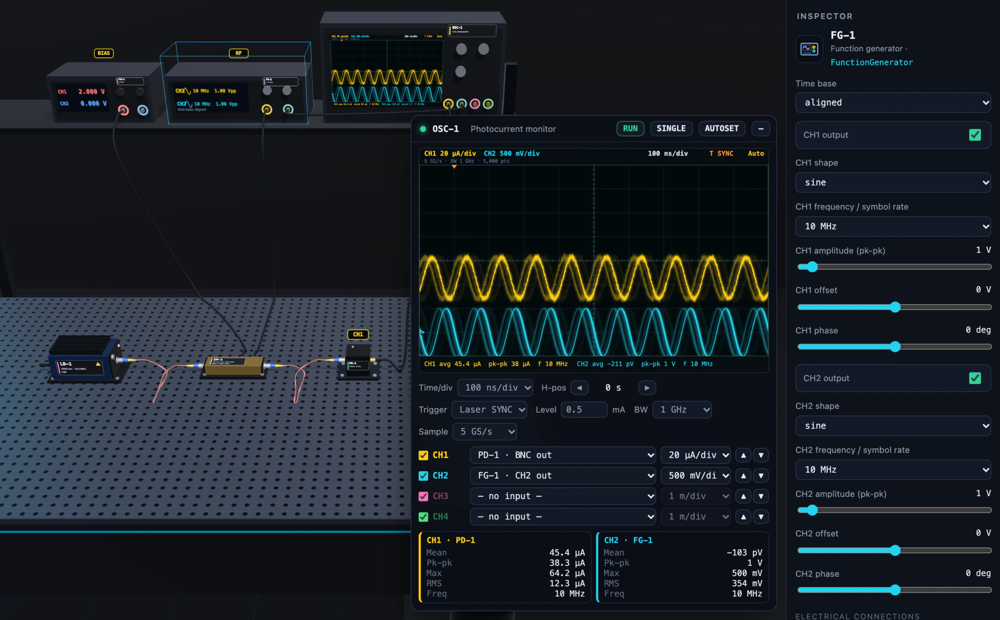
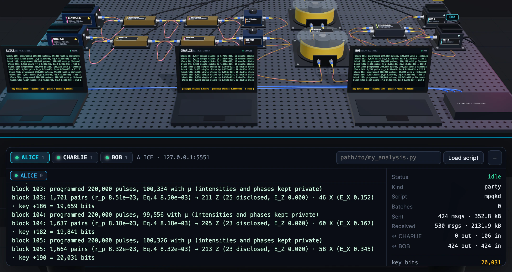

# phoq

[](https://github.com/ammar-faifi/phoq/actions/workflows/ci.yml)
[](https://pypi.org/project/phoq/)

**phoq** (photon + q, it sounds like Fock) is a quantum optics and quantum-communication lab for Python.

Build fiber-optic experiments from parts — lasers, modulators, couplers, attenuators, photodiodes, single-photon
detectors, arbitrary waveform generators, time taggers, oscilloscopes — run them, post-process the clicks
with your own scripts, and run multi-party protocols such as QKD with every party in its own
process talking over real sockets. A 3D virtual lab in the browser shows the same Python objects
live and lets you edit them.

phoq's models of lasers, couplers, modulators, photodetectors, delay
lines and the spectrum analyzer, its quantum random number generator, COW with a vacuum decoy
sequence and MP-QKD's error correction are checked against seventeen references, from journal
papers to instrument manuals and application notes, in
[Checked against the literature](#checked-against-the-literature).

The details are in three more READMEs: [docs/README.md](docs/README.md) for the engine
(components, connectors, the command line, analysis scripts, the parties framework, the
physics model and the theory of each instrument), [examples/README.md](examples/README.md) for
the examples and the QKD protocols, and [src/phoq/presets/README.md](src/phoq/presets/README.md)
for the part presets.


*The virtual lab serving MP-QKD (`phoq serve --protocol mpqkd`): Alice's and Bob's transmitters,
Charlie's detectors, the instrument shelf and a laptop per party.*



*`examples/modulated_link.py`: the scope shows the photocurrent (CH1) next to the generator's
10 MHz drive (CH2).*



*Alice's console: each block's pairs and sifted bits, and her traffic with Charlie and Bob
(taken before error correction and privacy amplification were added).*

## Quick start

```bash
pip install phoq
```

`pip install "phoq[plot]"` adds matplotlib for the plotting helpers. Python 3.14 or newer.
Inside this repository, `uv sync` installs everything and commands are run with `uv run …`.

```python
from phoq import Setup, Laser, Fiber, Photodiode, Oscilloscope

laser = Laser(power_dbm=-7, mode="pulsed", rep_rate=10e6, pulse_width=5e-9)
setup = Setup.from_chain(laser, Fiber(length=2), Photodiode(bandwidth=1e9), Oscilloscope(timebase=20e-9))

print(setup.run().summary())     # OSC-1: ch1 ← PD-1: mean 163 µA, pk-pk 2.99 mA, f 10 MHz
laser.power_dbm = 0              # parameters are plain, validated attributes
setup.serve()                    # optional: http://127.0.0.1:8000 shows it live in 3D
```

```bash
phoq run examples/delay_line.py              # headless
```

```bash
phoq serve examples/basic_link.py            # the virtual lab at http://127.0.0.1:8000
```

```bash
phoq serve --protocol examples/mpqkd         # MP-QKD: Alice, Bob and Charlie as processes
```

```bash
phoq run --protocol bb84 --party examples/bb84/eve.py   # decoy-state BB84 with an eavesdropper
```

[docs/README.md](docs/README.md#command-line) explains every command and option.

## Examples

Each runs headless with `phoq run` and opens in the virtual lab with `phoq serve`;
[examples/README.md](examples/README.md) has the details.

QKD protocols, each a directory with its parties and a README:

- [examples/mpqkd](examples/mpqkd/README.md): mode-pairing QKD with Alice, Bob and Charlie,
  from the clicks to a secret key.
- [examples/bb84](examples/bb84/README.md): phase-coding BB84 with decoy states, and an
  intercept-resend eavesdropper.
- [examples/cow](examples/cow/README.md): coherent one-way QKD up to the sifted key, and an
  attack in the time basis.
- [examples/cow_vacuum](examples/cow_vacuum/README.md): COW with a vacuum decoy sequence, up
  to the bound on the phase error rate.

Benches and measurements:

- [basic_link.py](examples/basic_link.py): laser, patch cord, photodiode and oscilloscope.
- [delay_line.py](examples/delay_line.py): a pulse train split in two, one arm through a 1 km
  spool.
- [modulated_link.py](examples/modulated_link.py): an intensity modulator at quadrature, driven
  by the generator's sine.
- [connector_cascade.py](examples/connector_cascade.py): patch cords through mating sleeves, and
  what each mating costs.
- [mzi_interference.py](examples/mzi_interference.py): a fiber Mach–Zehnder swept through its
  phase.
- [iq_modulator.py](examples/iq_modulator.py): 16-QAM from a dual-parallel MZM, read back by a
  homodyne receiver.
- [odl_validation.py](examples/odl_validation.py): the optical delay line checked against its
  theory.
- [dli_for_dpsk.py](examples/dli_for_dpsk.py) and [dli_for_cow.py](examples/dli_for_cow.py): a
  delay-line interferometer ([dli.py](examples/dli.py)) as a DPSK demodulator and as COW's
  monitoring line.
- [balanced_detection.py](examples/balanced_detection.py): a weak heterodyne beat on a noisy
  local oscillator.
- [laser_noise.py](examples/laser_noise.py): intensity noise and shot noise, with a balanced
  detector and the spectrum analyzer; [laser_noise.md](examples/laser_noise.md) maps each noise
  onto the code.
- [linewidth_homodyne.py](examples/linewidth_homodyne.py) and
  [linewidth_narrow.py](examples/linewidth_narrow.py): a laser's linewidth by delayed
  self-homodyne, down to 100 Hz.
- [spad_comb.py](examples/spad_comb.py) and [spad_tones.py](examples/spad_tones.py): a SPAD's
  clicks on the spectrum analyzer, the comb and the clock's tone.
- [vacuum_noise_qrng.py](examples/vacuum_noise_qrng.py): a quantum random number generator from
  vacuum fluctuations.
- [clock_sync.py](examples/clock_sync.py): Alice's clock and the delay recovered from
  single-photon time stamps.
- [clock_sync_dli.py](examples/clock_sync_dli.py): the same at 1 GHz on three SPADs, a direct
  line and a DLI's bright and dark lines, each with its own pattern.
- [analysis_pairing.py](examples/analysis_pairing.py): an analysis script on Charlie's clicks,
  the mode-pairing rate against the paper's.

## Part presets

A preset sets a component up as a specific product, with every number traced to its datasheet:

```python
im = IntensityModulator("IM-1", preset="exail/mx-ln-10")   # Vπ 5.5 V (RF) / 4.2 V (DC), 22 dB ER, 3.5 dB
setup["DET-L"].apply_preset("mpd/pdm-ir")                   # on an existing part; "generic" goes back to the defaults
```

phoq ships presets for Exail modulators, Hamamatsu (formerly NKT Photonics) fiber lasers, MPD
and Excelitas single-photon detectors, Thorlabs photodiodes and balanced detectors, and FS patch
cords. `phoq presets` lists them, and [src/phoq/presets/README.md](src/phoq/presets/README.md)
has the table, the file format and how to add your lab's own.

## Adding a component

Subclass `Component`, declare `Param`s, create ports in `_build`, and describe the optics in
`scatter`. The class registers itself, shows up in the visualizer's toolbox and inspector, and
gets a generic 3D model until you add one in `src/phoq/web/js/parts.js`.

```python
import math
from phoq import Component, Param, Transfer

class Mirror(Component):
    category, prefix, label = "passive", "M", "Fiber mirror"
    reflectivity = Param(0.99, min=0.0, max=1.0)

    def _build(self):
        self.add_port("p1")

    def scatter(self, port, wavelength):
        return [Transfer(port, math.sqrt(self.reflectivity))]
```

## Checked against the literature

Each reference below was compared with the phoq code it covers (October–November 2026):

- *S. J. van Enk, "Coherent states, beam splitters and photons".* §8 and §12–14: a laser mode is
  a coherent state with Poissonian photon number $P(n) = e^{-|\alpha|^2}|\alpha|^{2n}/n!$ and mean
  $|\alpha|^2$, its initial phase is unknown, and a coherent state with a random phase equals a
  Poissonian mixture of number states. The `Laser` follows this: `mean_photon_number` $= E/h\nu$, a
  uniformly random start phase per acquisition, a Wiener-process phase whose correlation decays
  with the coherence time $1/\pi\Delta\nu$, and `phase_randomized` for weak-coherent-pulse
  sources. §16: a beam splitter maps
  $(\alpha_1, \alpha_2) \to ((\alpha_1 + i\alpha_2)/\sqrt2, (i\alpha_1 + \alpha_2)/\sqrt2)$,
  the convention `Coupler` uses, and §20 the Mach–Zehnder
  fringe $(1 - \cos\varphi)/2$ that the MZI tests reproduce.
- *J. A. T. Santiago, "Photon statistics for Fock and coherent states interfering in a beamsplitter"
  (arXiv:2508.08223).* Eq. (1.1) is the same beam-splitter transformation with $|t|^2$ equal to `ratio`;
  §4, Eqs. (4.3)–(4.7): two coherent inputs give product coherent outputs
  $|t\alpha + ir\beta\rangle|ir\alpha + t\beta\rangle$, still Poissonian ($Q = 0$,
  $g^{(2)}(0) = 1$). That is why the engine may
  add fields and then treat each detector's photon number as Poissonian with mean
  $\eta|E|^2\Delta t/h\nu$: the SPD's $p(\mathrm{click}) = 1 - (1 - p_\mathrm{dark})e^{-\eta\bar n}$ is
  exact for this light, and Charlie's two detectors in MP-QKD click independently. Fock-state
  inputs (§2–3), including Hong–Ou–Mandel interference, are outside the model: there are no
  single-photon sources, and a threshold detector facing $|1\rangle$ would click with probability
  $\eta$, not $1 - e^{-\eta}$.
- *C. Neumüller et al., "Bias control and linearization of the transfer function of electro-optic
  and acousto-optic modulators" (Fraunhofer IIS, 2024), §3.1.* Eqs. (1)–(3) give the phase
  modulator's $\varphi = \pi V/V_\pi$ and the origin of $V_\pi$; Eqs. (4)–(5) the MZM transmission
  $\cos^2(\varphi/2)$; Eq. (6) the finite extinction ratio from unequal arm powers, which replaced an
  earlier clamp in `IntensityModulator`; Eq. (7) the sum $V = V_\mathrm{RF} + V_\mathrm{DC}$ that the
  `rf` and `bias` inputs implement; Eq. (8) the drift term $\varphi_\mathrm{drift}$ behind the new
  `phi0`; and Eqs. (9)–(10) the push–pull drive. The paper's bias-control and predistortion
  sections (§4–5) are not modeled. AOMs are not part of the lab.
- *J.-Q. Chen et al., "Linewidth measurement of a narrow-linewidth laser: principles, methods, and
  systems", Sensors 24, 3656 (2024), [doi:10.3390/s24113656](https://doi.org/10.3390/s24113656).*
  §2.2 and Fig. 1b: the delayed self-homodyne interferometer that `examples/linewidth_homodyne.py`
  builds, and a beat twice as wide as the laser (here: the one-sided −3 dB point at $\Delta\nu$);
  §2.3.1 and Eq. (10): a Lorentzian once $\tau_d \gg \tau_c$; §2.3.4: the −20 dB width over $2\sqrt{99}$
  and Voigt fitting against 1/f noise. Eqs. (28)–(31), the spectrum for any delay: phoq averaged
  over the bias phase matches it to 0.07 dB rms at 0.3 and 1 km. §2.1, Eq. (4) and Fig. 2: a
  two-laser beat of width $\nu_t + \nu_r$, reproduced to within 2 %. Eq. (20): the frequency-
  discriminator limit behind the sinc² at short delays. Both checks are tests in
  `tests/test_spectrum.py`. Outside the model: 1/f noise, the self-heterodyne (no AOM), the
  recirculating, Brillouin and phase-noise (β-separation line) methods of §2.3.3–2.5.
- *D. J. Blumenthal, "Photodetection and Photodetectors", ECE228B Lecture 2 (UC Santa Barbara).*
  Slides 6–7: shot noise σ² = 2q(I_p + I_d)Δf, Poissonian but treated as Gaussian, with a flat
  density 2qI over the detector bandwidth. Checking this showed that phoq's photodiode had the
  right variance but spread it flat up to the sampling Nyquist frequency: at 50× oversampling the
  density inside the detector bandwidth was 15 dB too low. The noise now passes through the
  detector's pole with the signal, and its density is 2qI·|H(f)|² to within 1.5 %. Slide 10: the
  shot-noise-limited SNR ηP/(2hνB): phoq 1889, formula 1888 at 1 µW (η = 0.76, B = 1.57 GHz).
  Slides 11–12: the heterodyne beat 2R√(P_lo·P_s), reproduced to 10⁻⁴, and with a strong local
  oscillator SNR = ηP_s/(hνB), to 1 %; homodyne's further 3 dB (slide 14) follows from the same
  beat. Slides 17–18: R = ηq/hν with η ≤ 1 (the material tables peak at η = 0.85–0.86 for Si,
  GaAs and InGaAs, 0.58 for Ge) and the band-gap cut-offs (Si 1110, Ge 1850, GaAs 870 nm), which
  the tables respect up to the absorption tail of the datasheet curves. Tests in
  `tests/test_detector_noise.py`. Outside the model: photoconductive gain (slides 19–20).
- *I. S. Kolev, T. V. Karadzhov and E. N. Petkova, "Noises in Photodetectors", ICEST 2005, Niš,
  pp. 725–728.* Eqs. (20)–(21) and (28)–(29): thermal noise 4kTΔf/R and shot noise
  2q(I_ph + I_D)Δf, the two terms of phoq's photodiode. In the dark, with 50 Ω at 300 K, phoq gives
  (2qI_d + 4kT/R)·B to 0.2 %; there thermal noise is 10⁶ times the dark current's shot noise.
  §II.H: photon noise is Poissonian, √N, which is the single-photon detector's click statistics.
  Outside the model: 1/f (flicker) noise, which the paper finds insignificant above 10 kHz (its
  cut-off is at most 20 Hz for a PIN photodiode, and none at zero bias), and avalanche excess noise
  2qIΔf·M^X (Eq. 37).
- *K. Wang et al., "Design of optical fiber delay line with large delay range and low insertion
  loss", Front. Phys. 12:1362101 (2024),
  [doi:10.3389/fphy.2024.1362101](https://doi.org/10.3389/fphy.2024.1362101).* §2.2–2.3: the
  fiber's LP₀₁ mode as a Gaussian beam, collimated and refocused, with the insertion loss set by the
  Gaussian mode overlap (Eq. 7), which is the coupling phoq's `OpticalDelayLine` uses. Fig. 5 gives
  the coupling against a 0–1 m gap for 4, 8, 12 and 16 mm lenses at 633 nm. Traced from the figure
  and fitted with one parameter, the 4 mm curve's Rayleigh range (0.64 m, a 4.5 µm mode diameter),
  phoq matches it to 0.001 rms. Through z_R ∝ f² it predicts the 8 mm curve to 0.003 rms, and a
  0.8 % and 0.2 % drop over 1 m for 12 and 16 mm, where the paper finds less than 1 %; a test in
  `tests/test_odl.py` repeats this. Eq. (2): the rest of the insertion loss is the fiber end faces
  (4 %) and twelve lens surfaces, about 0.5 dB in all for their design, against phoq's assumed
  1 dB. Outside the model: the lens and fiber-end misalignments of Figs. 6–10, and the aberrations
  behind their measured 95.3 → 92.7 % over 0–1 m (Fig. 12), more than either diffraction model
  predicts.
- *Thorlabs, "PDB440x and PDB450x Balanced Amplified Photodetectors", operation manual, version 2.4
  (2019).* §3.3: RF OUTPUT $`= (\mathcal R P_1 - \mathcal R P_2)\,G`$, half of it into 50 Ω. The
  Technical Data give the CW saturation powers, the monitors' 10 V/mW and their saturation above
  1 mW. §3.6 measures the CMRR as one input against both, and §3.7 plots the path-length limit. phoq's
  `BalancedPhotodetector` reproduces each of them, mostly to better than 0.1 dB or 1 %; the table is
  in [Balanced photodetector](docs/README.md#balanced-photodetector), and the checks are in
  `tests/test_balanced.py`.
- *M. Seimetz, "High-Order Modulation for Optical Fiber Transmission" (Springer, 2009), ch. 2.*
  Eqs. (2.11)–(2.14): the MZM's field and power transfer, which phoq's MZMs follow with a finite
  extinction added. Eqs. (2.15)–(2.18): the IQ modulator at its operating point, reproduced to
  2·10⁻⁴. Eqs. (2.46)–(2.47): the arcsin drive of the conventional IQ transmitter, which places
  16-QAM and 64-QAM at ½(i + jq). Figs. 2.27–2.28: undershoots and chirp at the symbol
  transitions, which need the RF bandwidth phoq does not model. See
  [IQ modulator](docs/README.md#iq-modulator) and `tests/test_iq_modulator.py`. Eqs. (2.3)–(2.8): laser phase
  noise as a random walk with a Lorentzian line, which is `Laser.phase`, and RIN modeled as white
  Gaussian noise, which is `Laser.rin_db_hz`.
- *R. Paschotta, RP Photonics Encyclopedia:
  [phase noise](https://www.rp-photonics.com/phase_noise.html),
  [intensity noise](https://www.rp-photonics.com/intensity_noise.html),
  [shot noise](https://www.rp-photonics.com/shot_noise.html),
  [balanced photodetection](https://www.rp-photonics.com/balanced_photodetection.html).*
  - Phase noise: white frequency noise means $`S_\varphi \propto 1/f^2`$, specified by a linewidth or
    a coherence time; phoq's laser has exactly that. The beat and delayed-beat measurements are
    `linewidth_homodyne.py` and the two-laser test.
  - Intensity noise: RIN is a PSD in dBc/Hz, or an rms value over a stated band. That led to the new
    `Laser.rin_db_hz`, and to giving the balanced demo's 5 % rms its 30 kHz band.
  - Shot noise: $2q\bar I$, white and Gaussian, unchanged by η < 1. It is a property of the light,
    which phoq draws at detection; that is exact for coherent light, but excludes squeezed light.
    The docs now say "carries" where they said a diode "adds" shot noise.
  - Balanced photodetection: common noise cancels to the CMRR, while the two halves' shot noises are
    uncorrelated and add. `examples/laser_noise.py` reproduces 2q(I₊ + I₋) to ±0.3 dB and q to
    1 %.
  - [examples/laser_noise.md](examples/laser_noise.md) maps each article onto the code.
- *T. Gehring et al., "Homodyne-based quantum random number generator at 2.9 Gbps secure against
  quantum side-information", Nat. Commun. 12, 605 (2021),
  [doi:10.1038/s41467-020-20813-w](https://doi.org/10.1038/s41467-020-20813-w).*
  - Eqs. (3) and (49)–(51): Gaussian outcomes of variance g²(1+2n), and the ADC's d bins with end
    bins beyond ±R.
  - Eq. (67), maximized over δ: the min-entropy against quantum side information.
  - Eqs. (9)–(11): the same at the best ADC range.
  - Eqs. (14), (22), (24): correlated samples, through conditional variances from the PSD.
  - Eq. (1): the leftover hash lemma.
  - `examples/vacuum_noise_qrng.py` implements all of these and reproduces Table 1's 10.74 bits to 0.04 bit, and
    the 1024 extracted bits.
  - Not modeled: their ADC's non-linearity, measured at 7.23 bits of loss, and the transfer-function
    calibration of the vacuum level (in phoq the dark noise is measured directly).
- *S. Park et al., "Precision-balanced homodyne quantum random number generator with uncorrelated
  IID raw data and NIST-compliant full-entropy extraction", Phys. Scr. 100, 095117 (2025),
  [doi:10.1088/1402-4896/ae052e](https://doi.org/10.1088/1402-4896/ae052e).*
  - §3.1: quantum noise linear in LO power above the electronic noise. phoq: R² = 1.0000 (seeds
    1–3: 0.9999–1.0000), against their 0.9957.
  - §3.2: balancing the two photocurrents to keep the LO's noise out. phoq trims the coupler, as
    they trim the split with a half-wave plate.
  - §3.3: correlations falling as the bandwidth exceeds the ADC's Nyquist frequency.
  - Eqs. (7)–(8): the min-entropy against classical side information, which reproduces their 13.37
    bits exactly.
  - Not modeled: their NIST SP 800-90B assessment, SHA3-384 conditioning and SP 800-22 suite, which
    phoq replaces with a Toeplitz extractor and three quick checks.
- *R.-Q. Gao, Y.-M. Xie, J. Gu, W.-B. Liu, C.-X. Weng, B.-H. Li, H.-L. Yin and Z.-B. Chen, "Simple
  security proof of coherent-one-way quantum key distribution", arXiv:2107.09329v5 (2023).*
  - Appendix A: its gains, including those of the nonclassical $|0_x\rangle$, match an independent
    calculation from coherent-state matrix elements of the no-click operators, and so does the
    relation behind Eq. (5). Eq. (A5) follows from (A2)–(A4), and it brackets the true gains at every
    point tested.
  - Figs. 2, 3 and 5: `bound.optimum` gives $E_p^u$ from 0.174 at 0 km to 0.234 at 100 km (Fig. 3:
    about 0.17 to 0.24, read off its axis), and the rate falling to 10⁻⁸ at 68, 89, 100, 76 and 88 km
    (read off as 68, 90, 102, 76 and 88). The text's 0.005η² comes out as 0.0048η².
  - Not stated in the paper: how the misalignment $e_a$ enters. Here it goes into both $E_b$ and the
    |α,α⟩ monitoring gains, which gives those end points; on the data line alone it does not. Sec. III
    also calls $T_0$ the earlier moment, where its states and Eq. (4) need the later one.
  - Where the bench differs: the paper's gains put all of a pair's light into the interference, and
    a passive one-slot DLI holds half of that in the pair's slot. Its proof assumes exact vacuum, and
    a modulator leaks. `examples/cow_vacuum` counts what the hardware gives; see
    [its section](examples/cow_vacuum/README.md).
  - `tests/test_cow_vacuum.py` repeats all of this. Not modeled: the zero-error attack or any other
    attack on this variant, and finite-key effects.
- *R. Mueller, C. De Lazzari, F. Chirici, I. Vagniluca, L. K. Oxenløwe, S. Forchhammer, A. Zavatta
  and D. Bacco, "Performance of Cascade and LDPC codes for information reconciliation on industrial
  quantum key distribution systems", IET Quantum Commun. 6, e70003 (2025),
  [doi:10.1049/qtc2.70003](https://doi.org/10.1049/qtc2.70003).*
  - §2.2: Cascade as `examples/mpqkd/postprocess.py` runs it. Blocks of k₁ = 0.73/q̂ double on a
    new permutation each pass. A binary search discloses one sub-block parity per step, at most
    ⌈log₂ k₁⌉ of them, and every search of a level shares one message. Corrected bits cascade back
    into earlier passes, and the number of passes is fixed: six in phoq, which caps blocks at half
    the chunk, rounded up, and shuffles the first pass too. Their "additional checks" for parallel
    searches that end on the same bit are phoq's closing of every search that a flip has made even.
  - Eqs. (2)–(4): the leak is at least n H(q), f = leak/(n H(q)), and a Cascade leak is bounded by
    the parities Alice sends. phoq counts those parities on both sides and checks that the counts
    agree.
  - Fig. 3, §3.1 and §3.4: their numbers are for the efficient Cascade of Pacher et al. (2015) on
    2¹⁶-bit frames: f = 1.03–1.05 over 0.5–9 % QBER (read off Fig. 3), 400–700 messages per frame,
    and f = 1.036 with 446 messages on their live system. phoq runs the original protocol. In
    process on 2¹⁶-bit frames, with the true QBER as its estimate, it gives f = 1.149, 1.172, 1.197,
    1.215 and 1.236 at 1, 2, 4, 6 and 8 % (10–20 frames each), with 190–211 messages per frame and
    no frame left with an error (they report a frame error rate below 0.003).
  - §3.2: with a true 2 %, their f stays below 1.1 while the estimate is off by less than 3 %, and
    their messages grow with an overestimate, past 3,000 per frame. phoq's f is 1.10, 1.38 and 1.92
    at estimates of 1, 4 and 8 %, and its messages fall from 714 to 52: a smaller k₁ means more
    top-level parities and shorter searches. Their system estimates each frame's QBER from the
    errors corrected in the previous one (q̂ᵢ₊₁ = qᵢ) and discloses no sample. phoq's stations do
    the same, pooled over all the chunks verified so far (their §3.2 lets qᵢ span several keys),
    and start the first chunk at 1 % (`initial_qber`). At the showcase's E_Z of 4 × 10⁻⁴, the
    estimate a 10 % sample gives would cost 34.5 parities per chunk of 1,000–1,080 bits and the
    true value costs 15.8 (400 chunks in process); without the sample, a long run keeps about 17 %
    more final key per pulse.
  - §3.3, Eq. (11): each verified frame leaks its t tag bits, a failed frame counts as fully leaked,
    and clustering frames under one tag cuts the cost (t = 50, collision probability 10⁻¹⁰). phoq
    tags each 1,000-bit chunk with 32 bits (2⁻³² = 2.3 × 10⁻¹⁰), 3.2 % of the corrected bits, and
    discards a chunk whose tag differs.
  - `tests/test_phoq.py` checks that Cascade corrects, that both sides count the same leak, that
    1.0 ≤ f ≤ 2.5, the tag, and that each chunk's estimate is the error rate corrected before it
    (1 % for the first). The figures above are in-process runs, not tests;
    [examples/mpqkd/post_processing.md](examples/mpqkd/post_processing.md) has them. Not modeled:
    LDPC codes and the blind protocol, the efficient Cascade, frame clustering, and the latency and
    throughput of the classical channel.
- *Agilent, "Spectrum and Signal Analyzer Measurements and Noise", application note 5966-4008E
  (2012).*
  - p. 8: the log of the average is not the average of the log, so averaging noise on a log scale
    reads 2.51 dB low. phoq averages power: 400 sweeps of its noise floor read 0.02 dB from the true
    level when averaged in watts, and 2.51 dB below that when averaged in dB.
  - p. 19: noise scatters 4.35 dB/√N on the power scale and 5.57 dB/√N on the log scale. phoq's
    trace scatters 5.58 dB at one record, where nothing is averaged yet, and 0.65 dB at 48 records,
    which count as 45.5 independent readings: 4.35/√45.5 = 0.645 dB.
  - pp. 15, 20, 22: the averaging scale is independent of the display scale, and the video filter
    runs on a log scale on most analyzers, on a power scale on its PSA and X-Series. phoq shows dBm
    and averages on the power scale only: in the video filter, the detector and the trace average.
  - pp. 21–22: the rule σ = 9.3 dB·√(VBW/RBW), times about 0.8 on the power scale, runs high for a
    one-pole filter. At RBW/VBW = 100 it gives 0.93 and 0.74 dB for the note's four-pole RBW filter,
    where the exact variance and a simulation give 0.68 and 0.59 dB. So phoq's
    $`K = 0.475\,\mathrm{RBW}/\mathrm{VBW} + 0.62`$ does not come from it. Nor does the 15–20 % in
    [RF spectrum analyzer](docs/README.md#rf-spectrum-analyzer): the note's ratio of 5.57 to 4.35 is for
    independent readings, and a one-pole filter's are correlated.
  - Tests in `tests/test_spectrum.py` check the scatter and the power-scale trace average.
  - Not modeled: log and voltage averaging (1.05 dB low, p. 6), and so how the 2.51 dB builds up
    with RBW/VBW (Fig. 13, p. 15); peak-detected noise (pp. 17–18); channel power and ACP (pp.
    14–16); noise subtraction and noise floor extension (p. 25).
- *Keysight, "Spectrum Analyzer Basics: Fundamentals of Swept-Tuned, Superheterodyne Spectrum
  Analyzers", white paper 3123-1730.EN (2026).* pp. 22–26, the display detectors: a bucket is
  span/(points − 1), and phoq's *peak* takes its maximum, *sample* its value at the center, and
  *RMS* the power mean of all its bins, which the paper calls power (RMS) averaging. Not
  modeled: negative peak, normal and quasi-peak detection, voltage and log-power averaging, and the
  sweep-time limit of a swept filter (pp. 20–21).
- *Rohde & Schwarz, "Instrument Fundamentals: Spectrum Analyzers", seminar slides (PDF of March
  2023).*
  - Slides 11–13, the detectors: its RMS detector is a power average that reports the true noise
    power. phoq's *RMS* detector computes the same formula, on the bins and records of a sweep
    rather than samples over a pixel's dwell, and reads noise 0.01 dB from true. Its Average
    detector is a voltage average, 1.05 dB low, which phoq does not have: that formula reads 1.01 dB
    low on phoq's bins. A test in `tests/test_spectrum.py` checks both. Its sample detector with a
    trace average runs on a log scale, 2.51 dB low; phoq's stays on the power scale, so it reads
    2.51 dB above that setting.
  - Slides 22–24 and 29: a narrower VBW smooths the trace, leaves the level alone and slows the
    sweep. phoq's scatter falls from 5.5 dB at one record to 0.65 dB at 48, with the mean power
    within 0.01 dB, and the cost of a sweep grows with the records.
  - Not modeled: the compression behind the reference-level advice (slides 9–10), and the Auto Peak
    and negative peak detectors (slide 11).

## Repository layout

```
src/phoq/            the package; src/phoq/web is the virtual lab, shipped with it
src/phoq/presets/    part presets (.toml) from vendor datasheets, one file per part; README.md
examples/            setups, analysis scripts and the QKD protocols; README.md describes them
examples/mpqkd/      Alice, Bob, Charlie (+ station/common, keyrate, postprocess), the original
                     single-process reference.py with its [CLASSICAL #N] notes, and a README
examples/bb84/       decoy-state BB84: Alice, Bob (+ common), Eve as a --party file, and a README
examples/cow/        coherent one-way QKD up to the sifted key: Alice, Bob (+ common), Eve as a
                     --party file, and a README
examples/cow_vacuum/ COW with a vacuum decoy sequence up to the phase-error bound: Alice, Bob
                     (+ common, bound), and a README
tests/               pytest suite
docs/README.md       the engine in use: concepts, connectors, the command line, analysis
                     scripts, parties, the physics model, the instruments' theory, the server API
docs/engine.md       how the engine computes: tracing, field synthesis, detectors, instruments
docs/photon-counter.md  the time tagger's acquisition, dead time across records, long dead times
docs/tutorial-laser-noise.md  laser noise measured by hand in the 3D lab
docs/images/         README screenshots of the virtual lab
tools/walkthroughs/  builds src/phoq/web/walkthroughs, the walkthroughs the lab's Help links
.github/workflows/   ci.yml (tests on push / PR), publish.yml (PyPI on a version tag)
LICENSE              GNU Affero General Public License v3.0 or later
```

phoq is free software under the [GNU Affero General Public License v3.0 or later](LICENSE)
(SPDX: `AGPL-3.0-or-later`). If you run a modified phoq as a network service, the AGPL asks you to
offer its users the corresponding source.
