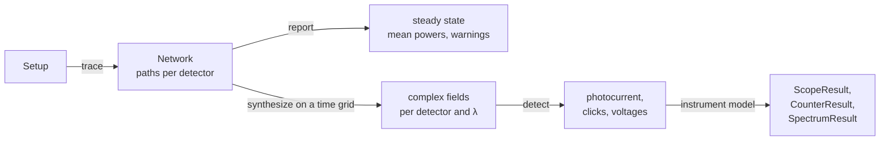

# How phoq computes: the core and the engine

This document explains what happens between building a `Setup` and reading a number off an
instrument: the object model, how light is traced through a setup, how fields are put on a time
grid, how detectors turn fields into currents and clicks, and how each instrument acquires. It ends
with what the model leaves out. It is written for people who extend phoq or want to know how far to
trust its results; the [README](../README.md) covers usage, and its *Theory* section the
modulator, oscilloscope and spectrum-analyzer physics in more depth.

| Module | Role |
| --- | --- |
| `core.py` | `Param`, `Port`, `Transfer`, `Component`, `Setup`: the object model |
| `engine.py` | `trace()` → `Network`, `synthesize()`, `report()`: the light |
| `sources.py` | `Laser`: the bin-averaged envelope and the phase noise |
| `passive.py`, `modulators.py` | `scatter()` of every optical part; modulators' time-dependent factors |
| `generators.py` | function generator and DC supply: the voltages that drive modulators |
| `detectors.py` | photodiode, single-photon detector, power meter |
| `instruments.py` | oscilloscope, photon counter (time tagger), RF spectrum analyzer |
| `runner.py` | `Runner`: acquire, run, sweep, average spectra |
| `server.py`, `parties.py` | the live lab's 15 Hz loop; protocol experiments block by block |
| `units.py` | constants, fiber and connector data, unit helpers |

## 1. The object model

**Parameters.** Every setting is a `Param` declared on the class: `Laser.power_dbm = Param(-7.0,
unit="dBm", min=-90, max=20)`. On an instance it reads and writes like a plain attribute, but every
write is converted to the declared type, checked against `min`, `max` and `choices`, and reported to
the setup's listeners (the lab server and autosave). `Param.spec()` describes the setting to the
web lab, which builds its inspector from it.

**Ports.** A `Port` belongs to a component and is `optical` or `electrical`, with a direction
(`in`, `out`, `bidi`) and at most one `peer`. Optical ports also have a connector type
(`FC/UPC`, `FC/APC`, `FC/PC`), which decides what a mated pair transmits and reflects.

**Components.** A `Component` subclass declares its `Param`s, creates its ports in `_build()`,
and implements whichever of these contracts apply:

| Method | Who implements it | Called by |
| --- | --- | --- |
| `scatter(port, λ) → [Transfer]` | everything light passes through | `trace()` |
| `envelope(t, dt)`, `phase(t, rng)` | `Laser` | `synthesize()` |
| `factor(t_mod, t_emit)`, `is_static()`, `mean_factor()` | modulators, switch routes | `synthesize()`, `mean_powers()` |
| `voltage(ch, t_mod, t_emit)`, `start(rng)` | generators, DC supply | modulators, instruments |
| `detect(fields, dt, rng, n)` | photodiode, single-photon detector | instruments |
| `acquire(net, rng) → Result` | instruments | `Runner`, the lab server, `Experiment` |

A `Transfer(port, amp, delay, mod)` says: light that entered through one port leaves through
`port`, multiplied by the complex amplitude `amp`, after `delay` seconds, and, if `mod` is set,
multiplied at that moment by the modulator's time-dependent factor. A component is therefore a
small scattering matrix with delays, plus at most one time-varying element per route. Subclasses
register themselves by class name, which is how JSON setups and the lab's toolbox find them.

**Setup.** A `Setup` owns named components and the connections between their ports.
`connect(a, b)` mates two ports. Two bulkhead optical ports never touch directly: phoq inserts a
1 m `Fiber` patch cord whose two connectors match the two ports, as a lab would. `chain(...)` wires
parts one after another through their declared `inputs` and `outputs`. A `MatingSleeve` is an
adaptor: the connectors plugged into its two sides mate with each other inside it. The setup
serialises to JSON and to a runnable Python script; part presets (`presets.py`) set a component's
parameters from a datasheet and are stored by id.

## 2. The pipeline



`trace()` runs once per snapshot of the setup and depends only on the setup. Everything random
happens afterwards, in `synthesize()` and the detector and instrument models, so one `Network` can
feed many acquisitions. Three callers drive the pipeline:

- **`Runner`** (headless): `run()` traces once and acquires every instrument on that snapshot,
  together with `report()`; `acquire()`, `sweep()` and `average_spectrum()` build on it. One
  `numpy` generator per runner, seeded by `Setup(seed=…)` or `Runner(seed=…)`, makes runs
  repeatable.
- **The lab server** (`phoq serve`): about 15 times a second it traces, sends the `report`, and an
  oscilloscope frame per running scope. A spectrum analyzer sweeps at most every max(0.2 s, 3 × its
  last sweep time), and photon counters acquire once a second.
- **`Experiment`** (protocols): per block of pulses, every party programs its generators
  (`prepare`), the time tagger records the block with `acquire(start=block·slots)`, and the party
  owning it receives the batch (`measure`).

## 3. `trace()`: from components to paths

phoq does not build a global matrix. It enumerates **paths**: for every laser, every way its light
can reach every detector, each with one complex amplitude, one delay and the list of modulators it
passes:

```python
@dataclass
class Path:
    source: Laser
    amp: complex          # product of every transmission on the way, including fiber phase
    delay: float          # sum of every delay on the way [s]
    mods: tuple           # ((modulator, delay at which the light reaches it), ...)
```

The tracer is a depth-first search with an explicit stack. Each entry is the port the light is
about to leave through, the amplitude and delay so far, the modulators met, a hop count, a
reflection count and the place of the last reflection. Popping an entry:

1. **Find the mating partner.** Normally the port's `peer`. If the peer is a `MatingSleeve`, the
   partner is whatever is plugged into the sleeve's other side.
2. **Open connector.** With no partner, a cord end is open: its emitted power is recorded in
   `Network.open_ends`, and the end reflects back into the fiber, 3.6 % (−14.4 dB, the glass–air
   Fresnel reflection) for a flat end, −60 dB for an angled one.
3. **Mated pair.** Otherwise `mating(type_a, type_b)` gives the power transmission and the power
   reflected back into each side: 0.3 dB and −50 dB for FC/UPC pairs, −60 dB for FC/APC pairs,
   about 5 dB and a 3.6 % reflection into the flat side when an angled connector meets a flat one.
   The transmitted part enters the partner; the reflected part re-enters the component it came from.
4. **Entering a component** (`_enter`): the power is added to `port_power` and, for a patch cord,
   to its forward or backward flow (the lab draws the light flow from this). A detector's `inp` ends
   the path and stores it in `Network.paths`. A laser ends it too and records the light in
   `Network.returned`: its own light by reflection site, others' by name. Anything else is asked for
   `scatter(port, λ)`, and every `Transfer` becomes a new stack entry with `amp × transfer.amp`,
   `delay + transfer.delay` and, for a modulator, the pair (modulator, delay at which the light
   reaches it).

A path is abandoned after 40 hops (`MAX_HOPS`), below a power gain of 10⁻¹⁸ (`MIN_GAIN`, −180 dB),
and after one reflection (`MAX_REFLECTIONS = 1`): a second reflection between two connectors is
≤ −80 dB for matching types. A 1 m FC/UPC cord from a laser to a photodiode therefore gives one
path to the detector, and the laser sees its two connector pairs at −50.0 dB and −50.6 dB (the far
one has crossed the near one twice).

The resulting `Network` holds:

| Field | Content |
| --- | --- |
| `paths` | detector → list of `Path` |
| `fibers` | cord name → forward and backward power and the dominant wavelength (for the lab's light flow) |
| `open_ends` | each open connector's emitted power and wavelength |
| `port_power` | `"NAME.port"` → power arriving there (absolute maximum ratings) |
| `returned` | laser → light coming back into it, by reflection site or by the other laser's name |

Fiber is handled entirely inside `scatter`: a `Fiber` or `FiberSpool` of length $L$ multiplies the
amplitude by $10^{-\alpha(\lambda)L/20}\,e^{-i2\pi n_\mathrm{eff}L/\lambda}$, with $\alpha(\lambda)$
the SMF-28 attenuation table (0.19 dB/km at 1550 nm), $n_\mathrm{eff} = 1.4677$, and adds a group
delay $n_g L/c$ ($n_g = 1.4682$, 4.9 ns/m). A `BeamSplitter` with bar ratio $r$ and excess loss is
the unitary $b_1 = \sqrt r\,a_1 + i\sqrt{1-r}\,a_2$, $b_2 = i\sqrt{1-r}\,a_1 + \sqrt r\,a_2$, in both
directions. Because the phase of each path is exact, interference between paths with any delay
difference is exact too; the price is that the path count grows with every interferometer in
series.

## 4. The laser's field

A laser emits the complex field, in √W,

$$E(t) = \sqrt{P(t)}\;e^{i\varphi(t)}$$

**Envelope, bin-averaged.** Instruments sample time in bins $[t, t+\Delta t)$, and $\Delta t$ ranges
from picoseconds (a fast scope) to hundreds of microseconds (a narrow-RBW spectrum analyzer). Point
sampling would make results depend on where the samples fall: a 100 ps pulse sampled every 1 ns is
missed between samples, or, if a sample lands on its peak, over-counted. phoq never samples the
envelope; `envelope(t, dt)` returns the square root of the **power averaged over each bin**,
computed in closed form:

| Mode | Average power over $[t, t+\Delta t)$ |
| --- | --- |
| `cw` | $P$ |
| `sine` | $P\left[1 + m\,\dfrac{\cos\omega t - \cos\omega(t+\Delta t)}{\omega\Delta t}\right]$ |
| `ook` | $\dfrac{P}{d}\cdot\dfrac{\mathrm{on}(t+\Delta t) - \mathrm{on}(t)}{\Delta t}$, with $\mathrm{on}(x)$ the cumulative on-time at duty $d$ |
| `pulsed` | $\dfrac{P}{f}\cdot\dfrac{C(t+\Delta t) - C(t)}{\Delta t}$, with $C(x) = \sum_k \tfrac12\big[1 + \mathrm{erf}\big((x - k/f)/\sigma\sqrt2\big)\big]$ |

Pulses are Gaussian, centred on $t = k/f$, with $\sigma = \min(\mathrm{FWHM}, 0.45/f)/2.355$. The
energy is exact at any bin size: a 100 ps pulse train integrates to 1.000000 pulse energy per period
with bins of 1 ps, 10 ps, 1 ns or 100 ns, while point-sampling it at 1 ns gives 9.4× the energy in
the same test. Within a bin the field has no structure, so a detector sees the bin's energy.

**Phase noise.** $\varphi$ is a Wiener process: a uniform random start, plus independent Gaussian
increments with $\mathrm{Var}[\varphi(t+\tau)-\varphi(t)] = 2\pi\Delta\nu\,\tau$, where $\Delta\nu$ is
`linewidth`. That is white frequency noise and a Lorentzian line of full width $\Delta\nu$; the field
correlation decays as $e^{-\pi\Delta\nu|\tau|}$, so the coherence time is $\tau_c = 1/\pi\Delta\nu$.
(Measured on the code: 0.641 rad² at τ = 1 µs and 100 kHz, against 2πΔντ = 0.628.)
`phase(t, rng)` evaluates **one** realisation at an arbitrary set of times, including repeated ones:
it sorts them, draws the increments between neighbours and puts the result back in place. This is
what makes interference physical: two paths with delays $\tau_1$ and $\tau_2$ read the same random
walk at $t-\tau_1$ and $t-\tau_2$. `detuning` adds $2\pi\,\delta f\,t$, which is how two lasers beat at
a chosen offset. `phase_randomized` adds a fresh uniform phase per pulse slot, for weak-coherent-
pulse sources.

## 5. `synthesize()`: paths on a time grid

`synthesize(net, detectors, t, dt, rng)` returns, for each requested detector, a dict
wavelength → complex field array on the grid `t` (bin starts), in √W:

1. **Start the generators** that drive any modulator on those paths (`start(rng)`); a free-running
   generator draws a random epoch here.
2. **Group paths by laser.** For a laser with paths of delays $\tau_j$, the emission times are
   `emit = t − τⱼ` (bin starts) and `mid = emit + dt/2` (bin centres).
3. **One envelope and one phase call per laser**, over all its paths at once:
   `envelope(emit, dt) · exp(i·phase(mid, rng))`. Every path of that laser shares the realisation.
4. **Per path**, multiply by `amp`, then by each modulator's factor at the moment the light passes
   it: `mod.factor(t_mod = mid + at, t_emit = mid)`. The emission time is passed too, because a
   generator on the *aligned* time base indexes its pattern by emission time, so pattern symbol $k$
   meets pulse $k$ whatever the fiber delay to the modulator.
5. **Sum the paths of one wavelength coherently.** Different wavelengths stay separate keys and
   add in power at the detector. Two lasers at the same wavelength interfere and beat at their
   `detuning` difference.

**Why bin centres.** Phases and modulator voltages are evaluated at the bin centre. Pulses and
pattern symbols are centred on $k/f$; evaluating at bin starts would put many samples exactly on a
symbol boundary, where rounding decides the symbol.

**Cost.** Memory and time scale as (number of samples) × (number of paths of each laser), because
the phase walk is evaluated on the union of all paths' emission times.

## 6. Detectors

**Photodiode** (`detect` returns current in A, one value per bin):

$$i = I_\mathrm{dark} + \sum_\lambda \mathcal R(\lambda)\,|E_\lambda|^2$$

followed by the bandwidth as one exact discrete pole, $\alpha = 1 - e^{-2\pi B\Delta t}$, then
Gaussian noise of variance $(2qi + 4k_BT/R_\mathrm{load})\,B_N$ per sample, with the one-pole noise
bandwidth $B_N = \min(\tfrac{\pi}{2}B,\ 1/2\Delta t)$, and finally a soft saturation
$x \to x/(1 + (x/I_\mathrm{sat})^4)^{1/4}$. $\mathcal R(\lambda)$ is the material's typical curve or
a preset's datasheet curve, scaled to the responsivity at the reference wavelength. Instruments
start the record early by `settle_time` = $6/2\pi B$ so the filter has settled.

**Single-photon detector** (`detect` returns a boolean per bin). The mean photon number in a bin is
$\bar n = \sum_\lambda k(\lambda)\,|E_\lambda|^2\,\Delta t / h\nu$, with $k(\lambda)$ the preset's
spectral efficiency curve relative to its reference wavelength (1 without a curve). Each bin clicks
with

$$p = 1 - (1 - p_\mathrm{dark})\,e^{-\eta\bar n}, \qquad p_\mathrm{dark} = 1 - e^{-R_\mathrm{dark}\Delta t}$$

independently, which is exact for coherent light: its photon number is Poissonian. Dead time then
removes every click within $\lceil t_d/\Delta t\rceil$ bins of the last kept one (non-paralysable).
For an oscilloscope, `waveform()` turns clicks into 1 V, 5 ns pulses.

**Power meter.** No time grid: it reads `Network.mean_powers` (section 8), weighted by its InGaAs
head's responsivity relative to the calibration wavelength.

## 7. Acquisition

Every instrument implements `acquire(net, rng)` and returns a result object with `summary()` (text)
and `to_json()` (what the lab draws). An acquisition always:

1. chooses a time grid from the instrument's settings,
2. calls `synthesize()` for the detectors on its inputs,
3. runs the detector models,
4. applies the instrument's own signal chain and measurements.

Each acquisition draws fresh randomness: a new phase walk, new noise, new clicks. Two
acquisitions are independent records, not consecutive pieces of one record.

### Oscilloscope

- **Record.** A window of 10 divisions, $W = 10\,s_\mathrm{div}$. The sample rate is capped by the
  record memory, $f_s = \min(f_\mathrm{set}, N_\max/W)$, so $N = f_sW$ points (at least 100). At
  1 µs/div with 5 GS/s and 20 000 points: 2 GS/s, 20 000 points, 0.5 ns apart.
- **Analogue signal.** Simulated $k = \lceil 6\,f_\mathrm{BW}\Delta t\rceil$ times finer than the
  sample interval (capped so the grid stays under 200 000 samples), starting early enough for the
  photodiode and front end to settle. Inputs are photodiode currents, single-photon-detector pulse
  trains, or generator voltages.
- **Front end.** Two identical poles at $1.554\,f_\mathrm{BW}$, so the −3 dB point is the set
  bandwidth.
- **Sampling.** Every $k$-th sample: point sampling with no anti-alias filter, so a signal above
  half the sample rate aliases, as on a real scope.
- **Trigger.** *sync* puts $t = 0$ on a pulse of the laser feeding the inputs, with one division of
  pre-trigger. *edge* simulates twice the record and starts at the first rising crossing of the
  level. *free* starts anywhere. Single shot (`arm()`, `single()`) keeps the first triggered record.
- **Measurements.** Mean, extremes, peak-to-peak and RMS on every sample; frequency from hysteretic
  mid-level crossings, or from the FFT peak when the trace is coarsely sampled. Records over 2 000
  points go to the screen as a min/max envelope per column.

### Photon counter (time tagger)

- **Bins.** One bin per pulse: the bin rate is `bin_rate` or the repetition rate of the laser
  feeding its detectors. Bin $k$ is centred on pulse $k$; with `compensate_delay` the bins shift by
  the shortest delay from that laser, so bin $k$ holds pulse $k$ after the fiber.
- **Continuous clock.** The instrument keeps a running bin index, so `timestamps()` keep counting
  across acquisitions; a protocol sets `start` explicitly per block.
- **Chunks.** Long records are synthesized in chunks of `chunk` bins (one million by default).
- **Result.** A boolean click record per channel; `timestamps`, `events`, `counts`, `rates` and
  `coincidences` are derived from it. Clicks have no position inside their bin.

### RF spectrum analyzer

An FFT analyzer: for stationary signals it estimates the same thing as a swept one, the power in the
resolution bandwidth against frequency, in dBm into its input impedance.

- **Sample rate and record.** $f_s = 2.56\,f_\mathrm{stop}$. A periodic Hann window has an
  equivalent noise bandwidth of $1.5 f_s/N$, so the record is $N = 1.5 f_s/\mathrm{RBW}$ samples
  ($1.5/\mathrm{RBW}$ seconds), and the RBW is a noise bandwidth.
- **Averaging.** $K$ = `averages` records, overlapped by half (Welch), are power-averaged per sweep.
  A sweep is capped at 4 million samples: fewer averages first, then a coarser RBW.
- **Signal.** Simulated at $4f_s$, then low-passed and decimated by a polyphase FIR (`resample_poly`).
  Unlike the scope's point sampling, a signal above the span does not fold into it. A photodiode's
  current becomes a voltage across the input impedance; the input is AC-coupled, so the mean is
  removed.
- **Instrument noise.** White noise at the displayed average noise level (`noise_floor`, dBm/Hz) is
  added at the input; the photodiode's shot and thermal noise come from its own model.
- **Spectrum.** Each record is zero-padded 4× (a tone's level is right wherever it falls between
  bins) and scaled as $P_k = 2|X_k|^2/(R_\mathrm{in}(\sum w_n)^2)$: a sine of amplitude $A$ reads
  $A^2/2R_\mathrm{in}$ whatever the RBW, and white noise reads its density times the RBW.
- **Display.** `points` frequencies from start to stop. Each display point takes the FFT bins in its
  bucket through the detector: *peak* (tones), *average* (noise) or *sample*. The trace mode
  (*write*, *average*, *max hold*) combines sweeps.
- **Results and fits.** `SpectrumResult` keeps the display trace and the full-resolution bins
  (`psd()`): peak, median level, $N$ dB widths, integrated power, a Lorentzian fit, and
  `fit_self_homodyne(tau_d)` for a delayed self-homodyne at any delay. `SpectrumResult.average()`
  and `Runner.average_spectrum()` combine sweeps, e.g. over an interferometer's bias phase.
- **Cost.** About $4 \times N(K+1)/2$ simulated samples per sweep, times the number of paths: a
  narrow RBW over a wide span is slow, as on a real analyzer.

## 8. The steady state: `report()` and `mean_powers()`

The lab needs every detector's mean power, the light flow in every cord and the warnings 15 times a
second, without a time grid. `Network.mean_powers(detector)` computes the time-averaged power per
wavelength directly from the paths:

$$\bar P = P_\mathrm{laser}\Big[\sum_j |a_j|^2 + 2\sum_{j<k}\mathrm{Re}(a_j a_k^*)\,\gamma(\tau_j - \tau_k)\Big]$$

summed over the paths of each laser (different lasers add in power), with the mutual coherence

$$\gamma(\tau) = e^{-\pi\Delta\nu|\tau|}\times(\text{overlap of the envelope with itself delayed by }\tau)$$

The overlap is $e^{-r^2/8\sigma^2}$ for Gaussian pulses, with $r$ the delay modulo the period, and the
overlap of the on-windows for OOK. For phase-randomised pulses it is zero between different pulses.
Modulators enter with their exact complex factor when static, and with the square root of their
mean power factor when driven. Two paths that pass driven modulators interfere only if they pass the
same ones and have equal delays; otherwise they add in power. On an unbalanced Mach–Zehnder the
steady state agrees
with the time average of synthesized fields: 0.1085 mW against 0.1091 ± 0.0016 mW with a 300 m arm
($\gamma = 0.63$ at 100 kHz), and 0.268 against 0.274 ± 0.003 mW with 3 km ($\gamma = 0.01$).

`report(setup, net)` builds on it:

- **Per detector:** incident power; photodiode current and status (linear, saturated, blind at this
  λ); a single-photon detector's photons per pulse, PDE at each wavelength, click probability and
  expected rate.
- **Per laser:** the back-reflection it sees and its strongest source.
- **Per cord and open end:** the light flow, and what each open end emits.
- **Warnings:** too much light on a single-photon detector; absolute maximum ratings from presets
  (optical input, bias voltage, RF drive, photons per pulse); a loaded pattern missing;
  open connectors emitting more than 1 µW; angled connectors mated to flat ones.

## 9. Conventions

- SI units throughout. Fields in √W, so $|E|^2$ is power. Powers in the API as `power_dbm`,
  losses as `*_db`.
- One-sided power spectral densities (W/Hz into the analyzer's input impedance).
- Beam splitter: real bar, $+i$ cross amplitude. Fiber: $e^{-i2\pi n_\mathrm{eff}L/\lambda}$ phase,
  $n_gL/c$ delay.
- Time: a generator's pattern symbol $k$ and a laser's pulse $k$ are centred on $t = k/f$; the
  photon counter's bin $k$ is centred on pulse $k$.
- Randomness: one `numpy.random.Generator` per runner or session; `Setup(seed=…)` makes a run
  repeatable.

## 10. Current limitations

**Light and fiber**

- Scalar fields: no polarization, so no polarization drift, no polarization-dependent loss and no
  need for polarization controllers; interferometers have perfect polarization overlap.
- No chromatic dispersion: fiber adds loss, phase and a group delay, but pulses do not broaden.
- No nonlinearity (self-phase modulation, Brillouin, Raman) and no Rayleigh backscattering.
- Fiber phase is static: no thermal or acoustic phase drift, so an interferometer's bias phase never
  wanders (the delayed self-homodyne needs an explicit phase step for that reason).
- Couplers, attenuators, isolators and modulators are wavelength-independent; only fiber loss,
  detector responsivity and single-photon-detector efficiency depend on λ.
- At most one reflection per path, so no multi-reflection cavities; light returning into a laser is
  reported but does not affect it (an internal isolator is assumed).
- Path enumeration: the number of paths grows with every interferometer in series, and loops (fiber
  rings, recirculating delay lines) are cut at 40 hops and −180 dB. That cut also drops paths
  weaker than −180 dB, e.g. a second 500 km spool.
- No optical amplifiers, frequency shifters (AOM) or optical filters.

**Sources**

- Coherent states only: no single-photon or entangled-pair sources, no Fock-state statistics, no
  Hong–Ou–Mandel interference.
- Laser phase noise is white frequency noise only: no 1/f (flicker) frequency noise, no
  relative-intensity noise, no chirp, no relaxation oscillations, no wavelength drift.
- Pulses are Gaussian; no pulse shape from a datasheet.

**Modulators and electronics**

- Modulators respond instantly to the electrode voltage: no RF bandwidth or electrode capacitance,
  no bias drift or bias controller, no chirp, Vπ independent of wavelength and frequency.
- Generators are ideal: no rise time, jitter or output impedance.

**Detectors**

- Photodiode: one pole, Gaussian approximation of shot noise (fine except at a few photons per
  sample), no avalanche gain or excess noise, no ringing or impulse undershoot.
- Single-photon detector: no timing jitter (a click sits in its bin), no afterpulsing, no gating or
  twilight events. Dead time is non-paralysable and does not carry across acquisitions or chunks.

**Instruments**

- Oscilloscope: no ADC quantisation, trigger jitter or holdoff, equivalent-time sampling or probe
  loading.
- Photon counter: one bin per pulse, no timing resolution inside a bin and no tagger dead time.
- Spectrum analyzer: FFT method only (no video bandwidth, swept-filter artefacts, spurs or local-
  oscillator phase noise), a white noise floor, no input attenuator or compression. The lab window
  shows a plain Lorentzian half width, which assumes a delay much longer than the coherence time;
  the short-delay fit runs from Python.

**Time and statistics**

- Each acquisition, and each photon-counter chunk, draws a new laser phase walk: consecutive
  records are statistically independent, not continuous in phase.
- The time grid's cost is samples × paths. Long records with many paths, or a narrow RBW over a wide
  span, are slow; the analyzer reduces averages and then coarsens the RBW to stay under 4 million
  samples per sweep.
- `report()` is a steady-state estimate: it replaces driven modulators by their average and is not
  meant to reproduce single-record fluctuations.
