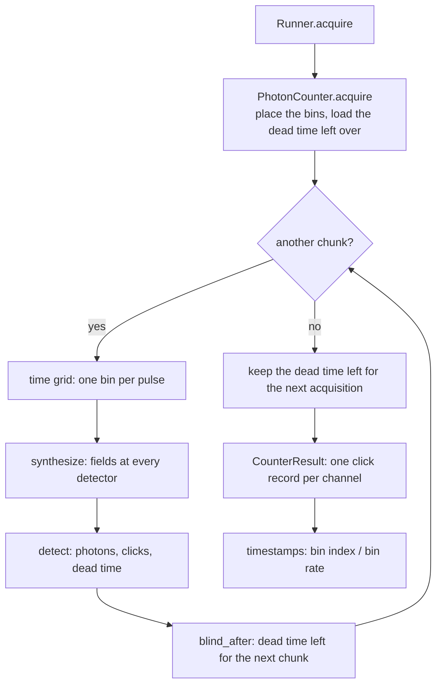
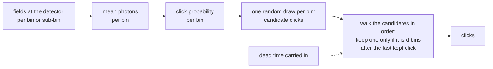
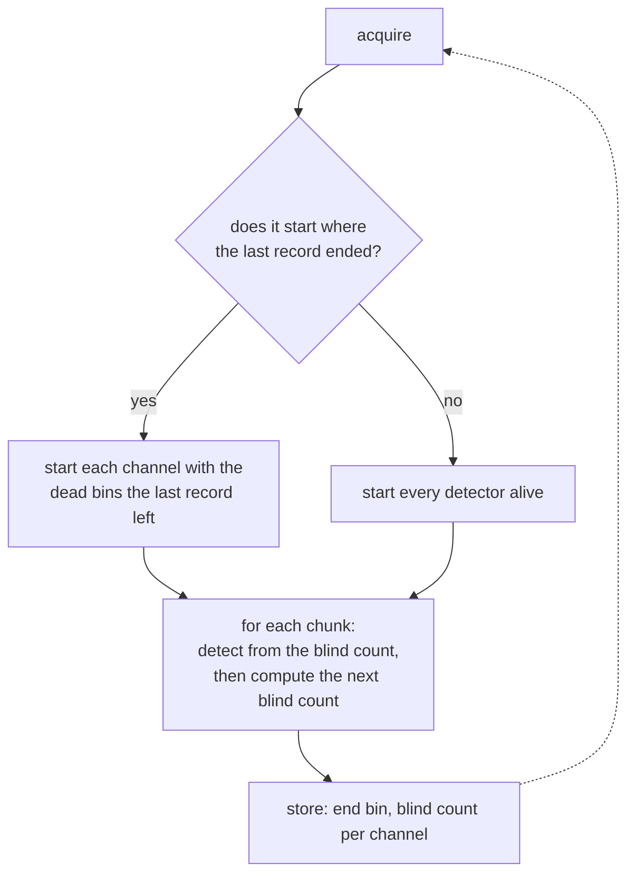
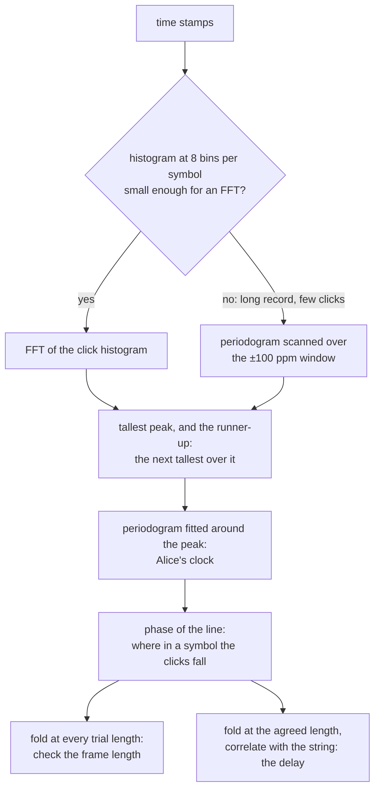

# The photon counter: from time bins to time stamps

`PhotonCounter` is phoq's time tagger. This document follows one acquisition through the code,
from the time grid to the clicks, and states at each step the physics that step encodes.
Most of the theory falls out of the code's own structure:

- The detector's dead-time rule makes the clicks a renewal process.
- Cutting the record into chunks threatens the dead time.
- Quantizing the time stamps to the bins puts a mirror in their spectrum.

The last part follows the time stamps into the clock-recovery analysis of
`examples/clock_sync.py`. There, a long dead time, the 40–100 µs a free-running InGaAs SPAD is held
off, strobes the very clock being recovered. [engine.md](engine.md) has the rest of the engine.



## 1. Placing the bins

Before any light is computed, `acquire` decides where its bins sit, which is the tagger's time
base.

- **The bin width.** It is Δt = 1/`bin_rate`, or one period of the pulsed laser feeding the
  detectors, so there is one bin per pulse.
- **The bin centres.** With delay compensation on, the grid is shifted by the earliest arrival of
  that laser's light. Bin $k$ then spans

  ```math
  [\,t_\mathrm{shift} + k\Delta t - \tfrac{\Delta t}{2},\; t_\mathrm{shift} + k\Delta t + \tfrac{\Delta t}{2}\,),
  ```

  centred on pulse $k$ after its time of flight.
- **A running clock.** The counter keeps a running bin index, so the next acquisition starts where
  this one ended, like a free-running tagger whose clock never stops. A time stamp is that absolute
  index divided by the bin rate.
- **Channel delays.** A channel's input delay is not added afterwards. It shifts the grid on which
  that channel's light is computed: channel N's bin $k$ holds the light that arrived `chN_delay`
  before the bin time. Its time stamps therefore read arrival time + delay, as a tagger's software
  delay does. Because the shift is in the grid, channels with different delays still see the same
  laser phase noise (section 2).

## 2. Chunks, and what crosses a cut

A record of 10⁸ bins cannot hold its fields in memory at once, so `acquire` walks through it in
chunks of a million bins (fewer with sub-bins). Each chunk is one call to `synthesize`, which puts
the complex field of every input detector on that chunk's grid. With $m$ sub-bins per bin it
computes $m$ times as many points, and the detector adds their photons.

**Within a chunk.** All channels are synthesized together, so they share the lasers' phase walks
and a generator's pattern: coincidences and interference between channels are physical.

**At a cut.** Everything stochastic in `synthesize` is drawn again:

- the lasers' phase walks;
- a free-running generator's start time.

An aligned generator indexes its pattern by emission time and carries straight on, so intensity
patterns do not notice the cut. An interferometer read through the counter does: its phase is
re-drawn once per chunk, one bin in a million. The only state that does cross a cut is the
detector's dead time (section 4).

## 3. From fields to clicks



`SinglePhotonDetector.detect` turns one chunk of fields into one chunk of clicks in four steps.
Each step is a piece of detector physics.

**Photons.** Fields are in √W, so a bin holds a mean photon number of

```math
\bar n_k = \sum_\lambda k(\lambda)\,\frac{|E_\lambda|^2\,\Delta t}{h\nu},
```

with $k(\lambda)$ the detector's spectral efficiency relative to its reference wavelength. With
sub-bins, their photons are summed into the bin.

**Click probability.** Coherent light has Poissonian photon numbers. A detector that is alive
therefore fires in bin $k$ with

```math
p_k = 1 - (1 - p_\mathrm{dark})\,e^{-\eta\bar n_k}, \qquad p_\mathrm{dark} = 1 - e^{-R_\mathrm{dark}\Delta t}.
```

This is exact for that light, not an approximation. Bins are independent, and a bin has at most
one click: a threshold detector does not count photons.

**Candidate clicks.** One uniform draw per bin decides where the detector *would* fire if it were
always alive.

**The dead time.** The dead time is $d = \lceil\tau_d/\Delta t\rceil$ bins; the ceiling ignores
float noise, so 40 µs at 10 ns is 4000 bins, not 4001. The candidates are walked in order, and one
is kept only if it lies at least $d$ bins after the last kept click. Two properties follow
directly from that rule:

- **Non-paralysable.** A candidate that falls inside the dead time is simply dropped. It does not
  restart the dead time, so a photon arriving while the detector is dead has no effect.
- **A renewal process.** After each kept click the detector is blind for exactly τ_d. It then waits
  a random time for the next candidate, independent of everything before. The time between clicks
  is τ_d plus that wait.

Let $R$ be the click rate of a detector that is alive, and $W = 1/R$ its mean wait. The renewal
picture then gives the click rate and the number of clicks in a record of length $T$:

```math
\text{rate} = \frac{1}{\tau_d + W} = \frac{R}{1 + R\,\tau_d}, \qquad N \approx \frac{T}{\tau_d + W}.
```

The rate saturates at 1/τ_d once $R\tau_d \gg 1$; this is the textbook non-paralysable dead-time
law, here a consequence of the keep-rule. In the clock example a fraction ⟨s⟩ of the symbols are
1s, each carrying μ photons, at symbol rate $f$. So

```math
R = f\,\langle s\rangle\,\bigl(1 - e^{-\eta\mu}\bigr) + R_\mathrm{dark}.
```

At 1 GHz with μ = 0.2 and η = 25 % this is about 25 million clicks per second, so W ≈ 40 ns. A
40 µs detector then clicks 50 times in 2 ms whatever the flux. phoq's counts match T/(τ_d + W) to
2 %.

## 4. The dead time across cuts



The keep-rule needs to know where the last click was. A chunk that starts with every detector
alive behaves as if the last click were infinitely far back. That is wrong whenever the previous
chunk ended less than τ_d after a click. So `detect` takes a *blind* count, the bins at its start
that are still dead, and treats it as if the last click were at bin blind − $d$. After the chunk,
`blind_after` computes what the next one inherits:

```math
\mathrm{blind}' = \begin{cases} \max(0,\; i_\mathrm{last} + d - n) & \text{the chunk has a click, the last at bin } i_\mathrm{last} \\ \max(0,\; \mathrm{blind} - n) & \text{the chunk has none.} \end{cases}
```

The second line matters when the dead time is longer than a chunk: a 100 µs dead time spans five
20 µs chunks. The counter keeps the last blind count with the bin where its record ended. The next
acquisition picks it up if it continues the record. One that starts elsewhere, at an explicit
`start`, begins with every detector alive.

**What went wrong before.** Until the blind count existed, every chunk started with every detector
alive.

- **Short dead times hid it.** As long as the dead time was a small part of a chunk, this added at
  most one early click per chunk, and nothing showed.
- **Long dead times broke the model.** At 20 ps bins a chunk is 20 µs. A saturated detector with
  τ_d = 40 µs then clicked once per chunk, at the chunk's first bright bin: 100 clicks in 2 ms
  instead of 50. Those clicks carried a 20 µs rhythm that came from the code, not the light.
- **Even at 1 µs it showed.** In the clock example's 2 ms record with a 1 µs dead time, the hundred
  chunk starts had added about 65 clicks. They also left a rhythm that the blind frame check scored
  at 23 σ; with the carry it scores 10 σ.

`tests/test_sync.py` puts a bright input on a 40 µs detector, with 10 µs chunks and two acquisitions
back to back. It must give exactly one click per 40 µs, and its smallest gap must be exactly 40 µs.

## 5. Following the time stamps: clock recovery with a long dead time



`recover_clock` looks for the line Alice's symbol clock $f_A$ leaves in the periodogram of the
time stamps:

```math
Z(f) = \frac1N\Big|\sum_i e^{2\pi i f t_i}\Big|^2 .
```

A record of tens of milliseconds at 1 GHz would need a histogram of 10⁸ bins or more. With only a
few hundred clicks, the code instead evaluates $Z$ directly across the search window. Either way,
the clicks fall on Alice's ticks, so at $f_A$ all their phases agree. The line's height is then
$`Z(f_A) = N D^2`$, where the depth $D$ is what the pulse width leaves of the agreement:
$`D = \mathrm{sinc}(\pi d)`$ for a pulse filling a fraction $d$ of the symbol, 0.90 at a quarter.

**What the renewal process adds.** From section 3, consecutive clicks are about $P = \tau_d + W$
apart. Evaluate $Z$ at $f_A + k/P$. Click $i$'s phase there differs from the line's by
$`2\pi k J_i/P`$, where $J_i$ is the sum of the first $i$ waits' departures from their mean. So the
phase is a random walk, with step variance

```math
s^2 = \Big(\frac{2\pi k\,\sigma_w}{P}\Big)^2 = \Big(\frac{2\pi k\,W}{P}\Big)^2 ,
```

since an exponential wait has $\sigma_w = W$. Averaging over that walk, with $\rho = e^{-s^2/2}$:

```math
\frac{\langle Z(f_A + k/P)\rangle}{Z(f_A)} \approx
\begin{cases}
1, & N s^2 \ll 1 \\[4pt]
\dfrac{1}{N D^2}\,\dfrac{1+\rho}{1-\rho}, & N s^2 \gg 1 .
\end{cases}
```

**Saturated, the clicks strobe the clock.** With W ≈ 40 ns against P ≈ 40 µs, $s^2$ ≈ 4·10⁻⁵.
Even 500 clicks give only $Ns^2$ ≈ 0.02. The line then has full-height copies every 1/P:

| Dead time | Copy spacing 1/P | At a 1 GHz clock |
| --- | --- | --- |
| 40 µs | 25 kHz | 25 ppm |
| 100 µs | 10 kHz | 10 ppm |

The clicks sample Alice's clock at an almost constant rate, and the line aliases as any sampled
signal does. The ±100 ppm search holds several copies.

- **Which copy the coarse peak picks is chance.** A longer record does not help, because $Ns^2$
  grows only as fast as $N$.
- **The rhythm also fools the frame check.** At 40,040 symbols per click, the epoch folding piles
  the clicks up at divisors of the rhythm, such as 4004, as if the frame were that long.

**The cure is irregular waits.** Attenuate until the live detector waits about a tenth of its dead
time: μ = 0.002 at 40 µs, 0.0008 at 100 µs. Then $s^2$ ≈ 0.31 and ρ ≈ 0.86, and the copies fall
to about $13/(N D^2)$ of the line: 3 % at N ≈ 455. The count barely changes, T/1.1τ_d. The
condition, $Ns^2 \gg 1$, reads $`W \gg P/(2\pi\sqrt N)`$: with fewer clicks the waits must scatter
more. An oscillator known to better than half the copy spacing, 1/(2τ_d f), picks the right copy
too: ±12 ppm at 40 µs, ±5 ppm at 100 µs.

**The runner-up.** Next to the coarse peak, `recover_clock` reports the tallest other peak in the
window, more than two FFT bins away, divided by the chosen one. It needs only the time stamps.
Near 1, the clock cannot be trusted. Below saturation it reads about 0.13 rather than the mean
copy height of 0.03, because the copies' own fluctuations peak a few times above their mean.

**What each later step needs.**

- **The delay** folds the symbol indices at the agreed L, so it needs only enough clicks to make
  one lag stand out: 45 clicks in 2 ms at 40 µs, below saturation, give +48 ps.
- **The frame check** tries thousands of lengths. The true one scores about $N/\sqrt{2L}$ σ, and it
  has to clear a noise floor near 4 σ. For L = 1000 that means about 450 clicks: 20 ms at 40 µs,
  50 ms at 100 µs.

From `examples/clock_sync.py`, at 1 GHz with 250 ps tagger bins:

| Dead time | μ | Record | Clicks | T/(τd + W) | W/τd | Runner-up | Clock error | Frame check (σ; best coprime) | Delay error |
| --- | --- | --- | --- | --- | --- | --- | --- | --- | --- |
| 40 µs | 0.2 | 20 ms | 500 | 500 | 0.001 | 1.00 | +0 ppb (by chance) | 4004, wrong (19 σ; 16.2 σ) | −0.1 ps |
| 40 µs | 0.002 | 2 ms | 45 | 46 | 0.097 | 0.38 | +43 ppb | 3271, wrong (7 σ; 6.1 σ) | +48 ps |
| 40 µs | 0.002 | 20 ms | 456 | 456 | 0.097 | 0.13 | −1 ppb | 1000 (11 σ; 4.3 σ) | −14 ps |
| 100 µs | 0.2 | 50 ms | 500 | 500 | 0.000 | 1.00 | −20 ppm: lost | 2565, wrong (23 σ; 19.0 σ) | lost |
| 100 µs | 0.0008 | 50 ms | 455 | 456 | 0.097 | 0.13 | +0 ppb | 1000 (8 σ; 3.9 σ) | +1 ps |

## 6. The tagger's bin, seen from the periodogram

**The bin must be under half a symbol.** A time stamp is a bin index over the bin rate, so every
$t_i$ is a multiple of the bin, $m_i\Delta$. Put that into $Z$:
$`e^{2\pi i (1/\Delta - f) m\Delta} = \overline{e^{2\pi i f m\Delta}}`$, so $Z(1/\Delta - f) = Z(f)$.
The periodogram is mirrored about the tagger's Nyquist frequency, 1/2Δ.

With bins of half a symbol the mirror sits on the clock. Alice's line at
$`f(1+23.4\,\mathrm{ppm})`$ then has an equally tall image at $`f(1-23.4\,\mathrm{ppm})`$, inside
the search. Run with 500 ps bins at 1 GHz, three of the five rows above lost the clock this way
(−46.8 or −23.4 ppm), and all five read a runner-up near 1. The image stays outside a ±δ search
only if $`1/\Delta \gt 2f(1+\delta)`$.

The pulse width, a quarter symbol here, is a natural bin. Its quantization adds about Δ/√12 rms,
comparable to the clicks' own spread within the pulse.

**Cost and long records.** Synthesis time and memory grow with bins × paths × sub-bins, while the
statistics depend on the clicks. In the clock example:

- 2 ms at 20 ps bins is 10⁸ bins and takes about 12 s;
- 2 ms at 250 ps is 8·10⁶ bins and takes about 4 s, analysis included.

An acquisition holds at most 10⁸ bins. `clock_sync.build` splits longer records into acquisitions
taken back to back, and `record` joins their time stamps. Section 4's carry keeps the detector dead
across the joins, so the result is one continuous record.

## 7. What the counter leaves out

- No tagger dead time or timing jitter: a click is stamped at the centre of its bin.
- No detector timing jitter, afterpulsing, twilight events or gating; the dead time is
  non-paralysable.
- One click per bin and channel: two photons in one bin are one click.
- A chunk boundary re-draws the lasers' phase walks and a free-running generator's start time
  (section 2). Only the dead time carries across.
