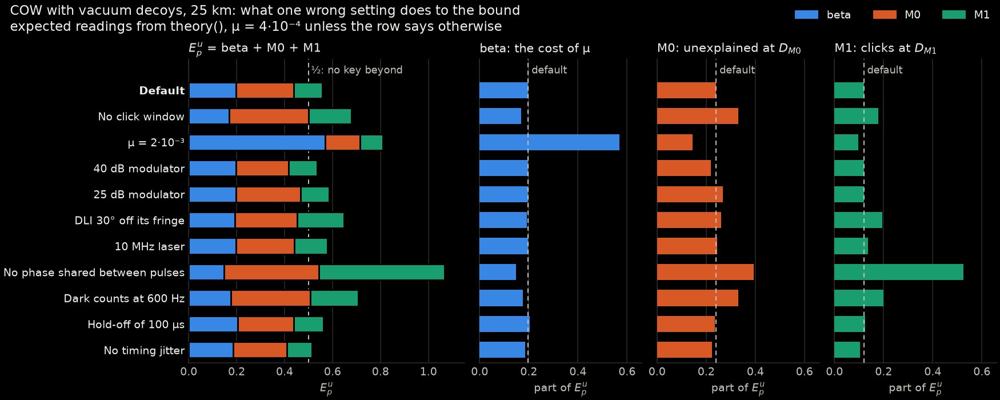

# COW with a vacuum decoy sequence, up to a bound on the phase error rate

`examples/cow_vacuum` runs the variant of Gao, Xie, Gu, Liu, Weng, Li, Yin & Chen, *Simple security
proof of coherent-one-way quantum key distribution*, arXiv:2107.09329v5 (2023). The zero-error
attack keeps the coherence between neighboring pulses that the visibility checks, so the paper stops
relying on the visibility. Alice adds one state, and the security figure becomes an upper bound
$E_p^u$ on the phase error rate, computed from what the monitoring line counts for each state she
sent. The hardware does not change.

The package stops at the sifted key, its bit error rate $E_b$ (the QBER) and $E_p^u$. Error
correction and privacy amplification are not implemented, and the paper's key rate, Eq. (6), appears
only in `bound.py`, to choose μ and to check its figures. No attack is simulated here.

```bash
phoq run --protocol cow_vacuum --blocks 20
```

```bash
phoq serve --protocol cow_vacuum
```

```bash
uv run phoq run examples/cow_vacuum/settings.py --plot settings.png   # one wrong setting at a time
```

**The states.** A pair takes two time slots: bit 0 is |0⟩|α⟩, bit 1 is |α⟩|0⟩, decoy sequence 1 is
|α⟩|α⟩ and decoy sequence 2, the new one, is |0⟩|0⟩. The data detector D_T reads the bit from the
time of arrival: T_0 is the slot where bit 0 has its pulse, and T_1 the other. (The paper's Sec. III
calls T_0 the earlier moment, but its states and its Eq. (4) need it this way. Only the label
differs.) A delay-line interferometer (DLI), one slot unbalanced, mixes a pair's two pulses in the
pair's second slot, to D_M0 (constructive) and D_M1.

**The bound.** The X-basis error rate of the paper's virtual protocol needs the gains of
$|0_x\rangle \propto |0\rangle|\alpha\rangle + |\alpha\rangle|0\rangle$, which nobody can send. Its
Eq. (A2) writes that state with the two decoy sequences and $|\beta,\beta\rangle$, the part of
|α⟩|α⟩ with a photon in both pulses. Cauchy's inequality bounds the cross terms by gains Alice and
Bob count, and $Q_{\beta\beta} \le 1$ is all that is known of the rest. `bound.terms` splits the
resulting Eq. (7) into three parts that add up to $E_p^u$, each pointing at different settings:

| Part | What it is | What raises it |
| --- | --- | --- |
| `beta` | \|β,β⟩'s own gain, bounded with $Q_{\beta\beta} \le 1$, and its cross term with \|α,α⟩ at D_M0 | too high a μ for the transmittance |
| `M0` | what the \|α,α⟩ and \|0,0⟩ gains at D_M0 leave unexplained of a single pulse's, and \|β,β⟩'s cross term with \|0,0⟩ there | a modulator's leak, lost interference, dark counts |
| `M1` | \|α,α⟩ and \|0,0⟩ clicks at D_M1, which should be dark, and their cross terms with \|β,β⟩ | the laser's phase noise, the DLI's phase, dark counts |

On a perfect bench (no leak, no dark counts, full interference) `M0` and `M1` go to zero, and `beta`
is what is left: the cost of μ at this transmittance.

With quiet detectors `beta` is most of it, and it grows with μ/η whatever Bob measures. So μ has to
fall with the transmittance, which is where the paper's $R \propto \eta^2$ comes from. The bound also
stands well above the error it bounds: at μ = 0.02 and η = 0.8 the true X-basis error rate is 0.003
and $E_p^u$ is 0.169. The visibility does not see any of this: at `examples/cow`'s μ = 0.5, V on this
bench is still 0.990, while Eq. (7) gives about 1,000, which bounds nothing.

**The bench.** The parts of `examples/cow` (30 dB modulator, 25 km, 50/50 tap), with InGaAs/InP
SPADs: the MPD PDM-IR preset (`mpd/pdm-ir`), free-running, at 25 % PDE, 250 Hz of dark counts,
which at this clock is 2.5·10⁻⁷ per slot, and 200 ps FWHM of timing jitter, with a 40 µs hold-off.
The datasheet quotes that PDE at 7 V of excess bias in fixed-gate mode, those dark counts at 2 V and
a 100 µs hold-off, and that jitter at 4 V, so a unit at full PDE counts more dark counts and jitters
less (100 ps at 7 V). The paper's simulation has 80 %, $p_d$ = 10⁻⁸, no hold-off and no jitter, and
gives no clock rate, decoy shares or μ. Here the clock is 1 GHz, each of the four states takes 25 %
of the pairs and μ = 4·10⁻⁴, near where $E_p^u$ is lowest on this bench and 1,250 times below
`examples/cow`'s.
Another distance, modulator or detector needs its own: `best_mu(setup, p)` finds it.

Bob reads his tagger as a bench does, from a time stamp per click. He folds the stamps onto Alice's
slots (`phoq.timing.fold`), which tells him each click's slot and where in the slot it fell, so his
click window can be the half of each slot that holds the pulse. That drops half of the dark counts
and the modulator's leak in the other half. The jitter costs the window some signal: a pulse fills
its half slot, so 6.8 % of its clicks are stamped beyond each edge, and the window keeps 86.4 %.
A click outside the window still blinds its detector for
40,000 slots, because every click counts, read or not. So `theory()` takes each detector's open
fraction from its count rate: 80 % on D_T, 92 % on D_M0 and 97 % on D_M1, which count 4.9, 2.0 and
0.8 kHz. D_M0 is the constructive port, and is hit about three times as often as D_M1 in every slot,
not only those Bob reads.

The stamps are still partly the simulator's. The tagger's bins, half a slot each, one symbol of the
modulator, are sampled on two sub-bins each (`SUB_BINS`), so a click is stamped where in its bin the
photon arrived, plus the detector's jitter; the tagger adds no jitter of its own. And the tagger's
delay compensation puts the center of the first pulse at time zero on its clock, so Bob never has
to find t₀, which a bench does once per session from its clicks or a sync channel.

Two other things differ from `examples/cow`. One slot is 1 ns, or 0.20 m of fiber, so the arms of the
DLI differ by a 0.25 m cord instead of 0.5 m, and the delay line in the short arm takes back the
224 ps that gives too much. Its 330 ps of travel covers clocks from 889 MHz to 1.26 GHz; `build`
refuses any other, which needs other cords. And a fixed 30 dB attenuator stands ahead of Alice's VOA,
because −10 dBm and the VOA's 80 dB limit stop at μ = 1.1·10⁻³. A block of 200,000 pairs takes 0.7 s
on an idle core, half of it for the second sub-bin.

**The protocol, per block:**

1. Bob reduces each pair to one event, inside his click window: D_T in T_0 or T_1, or D_M0 or D_M1
   in the pair's second slot. If several clicked he takes one at random, the paper's squashing rule.
   He announces the pairs with a data-line event, but not the slot, and the monitoring events with
   their detector. He also announces the monitoring clicks at the boundaries, the pairs' first
   slots, except beside a data-line event, where such a click would say something about that bit.
2. Alice flags the data-line events on decoys, which leave the key, discloses her bits at a random
   10 % of the rest, and publishes the gains: per state she sent, the events at D_M0 and D_M1. She
   also publishes the boundary clicks where both pulses were sent.
3. Bob answers with his bits at the sample. Both laptops show the same tally: $E_p^u$ with its
   counting error and its three parts, $E_b$, the sifted bits, the rare counts, and V inside the
   pairs and at the boundaries, neither of which is in the bound.

**What the real bench costs.** The paper's gains put all of a pair's light into the interference:
2μ(1 − t_B)η at D_M0 for |α,α⟩. A passive one-slot DLI holds half of that in the pair's second slot,
and the rest meets the neighboring pairs' pulses. At 25 km, with μ chosen to maximize Eq. (6) at each
step, or to minimize $E_p^u$ where no μ gives a key, and with the paper's detectors down to the 30 dB
modulator:

| Model, adding one effect per row | μ | $E_p^u$ | $Q$ (sifted per bit pair) |
| --- | --- | --- | --- |
| The paper's model, this bench's fiber | 8.4·10⁻³ | 0.236 | 7.9·10⁻⁴ |
| One-slot DLI | 4.2·10⁻³ | 0.239 | 3.9·10⁻⁴ |
| The DLI's 3.8 dB excess loss | 1.7·10⁻³ | 0.250 | 1.6·10⁻⁴ |
| 1 MHz laser | 1.6·10⁻³ | 0.251 | 1.5·10⁻⁴ |
| 40 dB modulator | 1.5·10⁻³ | 0.257 | 1.4·10⁻⁴ |
| 30 dB modulator | 9.9·10⁻⁴ | 0.270 | 9.3·10⁻⁵ |
| The SPADs' 25 % PDE | 3.2·10⁻⁴ | 0.310 | 9.3·10⁻⁶ |
| Their 250 Hz of dark counts | 5.2·10⁻⁴ | 0.618 | 1.6·10⁻⁵ |
| Their 40 µs hold-off | 4.9·10⁻⁴ | 0.623 | 1.1·10⁻⁵ |
| Their 200 ps timing jitter | 4.1·10⁻⁴ | 0.678 | 1.0·10⁻⁵ |
| A 0.5 ns click window | 3.7·10⁻⁴ | 0.557 | 7.9·10⁻⁶ |

Down to the 30 dB modulator $E_p^u$ hardly moves because μ absorbs each loss, so the cost is in the
sifted key: 8.5 times less, about 23 kbit/s at the real clock. Eq. (6) reaches 10⁻⁸ at 63 km there,
or 68 km with a 40 dB modulator, against 103 km in the paper's model at $e_a$ = 0.

The SPADs' dark counts end the key at 25 km. The |0,0⟩ gain enters Eq. (7) through its square root,
and μ cannot rise to drown it without raising `beta`. Read over the whole slot, no μ brings $E_p^u$
below 0.62, and Eq. (6) reaches 10⁻⁸ only to 0.25 km, or 3 km with a 40 dB modulator. The hold-off
adds 0.005 to that bound; what it takes is about a fifth of the sifted key. Their 200 ps of timing
jitter costs more read whole. A bit's pulse fills its half slot, and the jitter stamps the 6.8 % of
its clicks that come early in the slot before, the other bit's: $E_b$ rises from 0.019 to 0.070 and
$E_p^u$ to 0.68. The click window drops those clicks, with half of the dark counts and of the leak,
at the cost of the 13.6 % of each pulse's clicks stamped outside it. It brings $E_p^u$ down to 0.557
and $E_b$ to 0.014. That is still above 1/2 at 25 km, but $E_p^u$ now stays below 1/2 up to 20 km,
and Eq. (6) reaches 10⁻⁸ at 6 km, or 10 km with a 40 dB modulator. Without the jitter the window
would give 0.514, 24 km, 10 km and 13 km.

Three of these steps go beyond the paper. It does not discuss the light a passive DLI leaves out of
the pair's slot; the proof only asks for measured gains, so this package takes it as loss inside the
monitoring line, which is its own reading. The proof assumes exact vacuum: with a modulator's leak,
Eq. (7) is a formula evaluated on counted gains, not a proven bound. And its detectors have no
memory: with a hold-off, a click depends on Bob's earlier clicks, and Eq. (7) is again only evaluated.
`theory()` follows the jitter across the windows' edges (`spills`), and `tests/test_cow_vacuum.py`
checks it against runs with and without the click window, at 200 and 500 ps.

**Which setting is wrong.** The expected reading of the default bench at μ = 4·10⁻⁴, and what one
wrong setting does to it:

| Setting | $E_p^u$ | `beta` | `M0` | `M1` | V |
| --- | --- | --- | --- | --- | --- |
| Default | 0.557 | 0.198 | 0.240 | 0.119 | 0.938 |
| No click window | 0.678 | 0.169 | 0.330 | 0.179 | 0.883 |
| μ = 2·10⁻³ | 0.810 | 0.568 | 0.145 | 0.096 | 0.982 |
| 40 dB modulator | 0.535 | 0.198 | 0.219 | 0.119 | 0.938 |
| 25 dB modulator | 0.585 | 0.197 | 0.269 | 0.119 | 0.938 |
| DLI 30° off its fringe | 0.649 | 0.192 | 0.261 | 0.196 | 0.808 |
| 10 MHz laser | 0.579 | 0.196 | 0.245 | 0.138 | 0.911 |
| No phase shared between pulses | 1.067 | 0.148 | 0.394 | 0.525 | 0.000 |
| Dark counts at 600 Hz, the datasheet's maximum | 0.708 | 0.176 | 0.332 | 0.200 | 0.867 |
| Hold-off of 100 µs, the datasheet's | 0.563 | 0.203 | 0.235 | 0.125 | 0.934 |
| No timing jitter | 0.514 | 0.185 | 0.225 | 0.105 | 0.946 |



*`settings.py --plot`: the table, with $E_p^u$ stacked from its three parts, then each part on one
scale with the default dashed. Without `--plot`, `settings.py` prints the table.*

The modulator's leak matters more than its power suggests, because it adds to a pulse in amplitude:
√ε of the pulse's field against ε of its photons. The row with no shared phase uses a very broad
laser (`linewidth=10e9`), which does to the monitoring line what a gain-switched source does.

**The boundaries between pairs.** A pair's first slot holds its first pulse and the second pulse of
the pair before, and half of all monitoring clicks land in these slots. They stay out of Eq. (7),
which needs a gain per state Alice sent. Half of the time a |0,0⟩ pair's first slot holds the pair
before's pulse, so crediting these clicks to a pair would take $Q_{00}$ at D_M1 from 10⁻⁸ to
4.6·10⁻⁶ with the paper's detectors, and $E_p^u$ from 0.271 to 0.755. `examples/cow` counts them in
its V. Here they give a second V outside the bound, where both pulses were sent. On a healthy bench
it reads what V reads, from as many clicks, so it doubles the statistics for aligning the DLI, and
the settings above move both alike.

It parts from V at a phase break between pairs. A phase modulator at Alice's output that gives each
pair a new random phase keeps a pair's two pulses in step, so the gains, $E_p^u$ and V stay where
they are, and only the boundaries see it: at μ = 0.5 with no hold-off, 12 blocks read V = 0.997
inside the pairs and −0.033 at the boundaries (3,171 and 3,132 clicks). The paper's proof does not
rely on this coherence, so the bound is not expected to react.

**Reading it.** The single-process reference `run()` keeps both records in one place and compares
every figure with `theory()`, which computes the gains from the traced losses, the DLI's phase, the
laser's coherence and the modulator's leak:

```python
from phoq.loading import import_source

cv = import_source("examples/cow_vacuum")
print(cv.run(blocks=20, seed=4).summary())
```

```
COW with vacuum decoys over 25 km, μ = 0.0004, decoys 0.25 + 0.25, t_B = 0.5, 4,000,000 pairs (8,000,000 slots at 1000 MHz)
sifted 16: Q 8.004e-06 (expected 8.349e-06) · E_b 0.0000 on the whole sifted key (expected 0.0132)
E_p^u 1.440 ± 1.321 (expected 0.557): |β,β⟩ 0.240, M0 0.750, M1 0.450 (expected 0.198, 0.240, 0.119)
|α,α⟩ at D_M0 1, D_M1 0 · |0,0⟩ at D_M0 0, D_M1 1 · V 1.0000 (expected 0.9382, not in the bound)
boundaries where both pulses meet: D_M0 4, D_M1 0 · V 1.0000 (expected 0.9382, not in the bound)
```

The ± is the counting error: each of the eight counts moved by its Poisson σ, and by one count when
it is zero. It is not a finite-key term. The paper's bound is asymptotic, and a block holds about
0.8 sifted bits, 0.20 |α,α⟩ clicks at D_M0 and 0.006 at D_M1, so a short run is far from that limit.
It tends to read low while the rare gains count zero, and high once one of them counts a click, as
this one does. At the expected counts the counting error is 0.49 after 20 blocks (14 s), 0.054 after
1,000 (12 minutes) and 0.025 after 5,000 (an hour).

Over 2,000 blocks, eight seeds of 250 (400 million pairs), every count is within 1.5σ of what
`theory()` expects, and the seeds' readings (seeds 1 to 8) spread by 0.08 against the 0.10 expected
at 250 blocks:

| Quantity | Counted | Expected |
| --- | --- | --- |
| $Q$ | 8.38·10⁻⁶ | 8.35·10⁻⁶ |
| $E_b$ on the whole sifted key | 0.0113 (19 of 1,675) | 0.0132 |
| \|0,α⟩ events at D_M0, D_M1 | 123, 115 | 115, 108 |
| \|α,0⟩ events at D_M0, D_M1 | 111, 107 | 115, 108 |
| \|α,α⟩ events at D_M0, D_M1 | 413, 10 | 399, 12.7 |
| \|0,0⟩ events at D_M0, D_M1 | 17, 12 | 12.0, 12.1 |
| Boundary clicks where both pulses meet, at D_M0, D_M1 | 423, 14 | 399, 12.7 |
| V inside the pairs, at the boundaries | 0.953, 0.936 | 0.938, 0.938 |
| $E_p^u$ | 0.564 ± 0.037 | 0.557 |
| `beta`, `M0`, `M1` | 0.196, 0.261, 0.106 | 0.198, 0.240, 0.119 |

The comparison with the paper is in the main README, under
[Checked against the literature](../../README.md#checked-against-the-literature).
