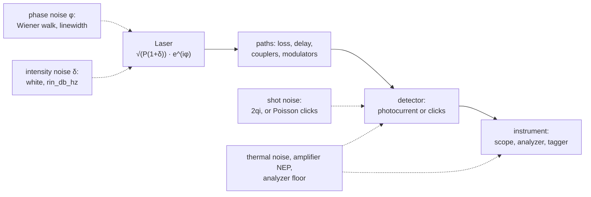
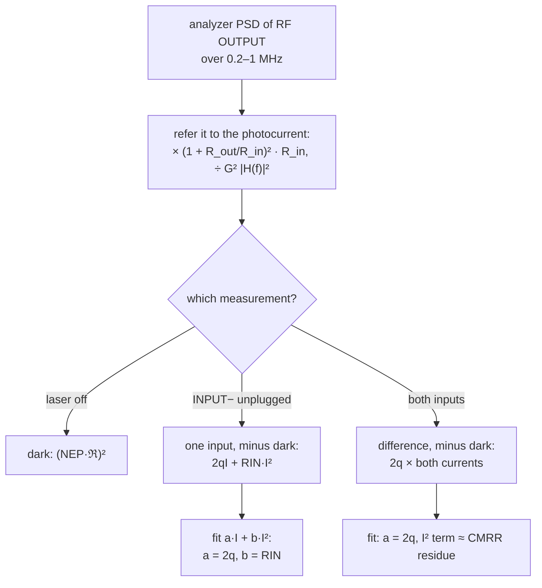
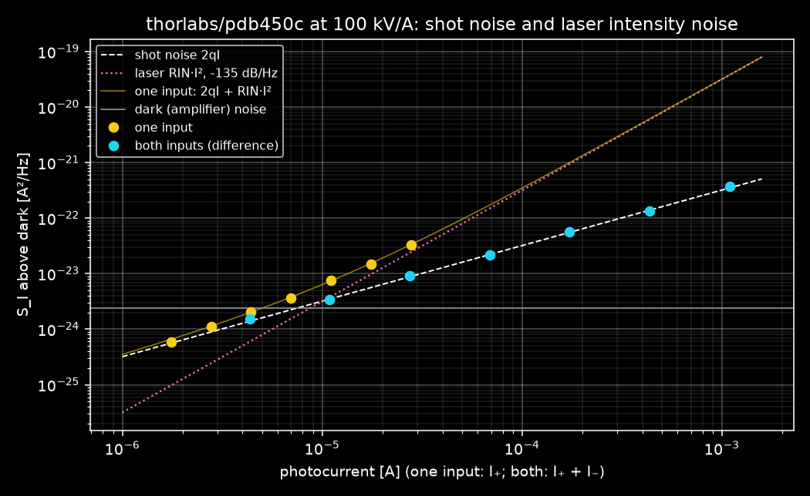
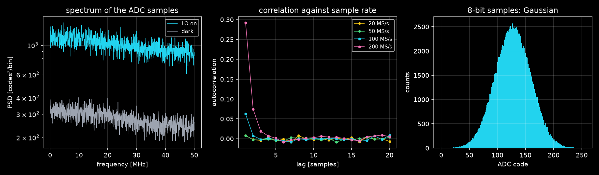

# Laser noise in phoq: phase noise, intensity noise, shot noise

This note maps four RP Photonics encyclopedia articles onto phoq's code: [phase noise][rp-phase],
[intensity noise][rp-int], [shot noise][rp-shot] and [balanced photodetection][rp-bal].

- **Where each noise enters.** It follows a field from the laser to a number on an instrument and
  names, at each step, the noise that is added there and what it means physically.
- **Terminology.** It checks phoq's terms against the articles' definitions.
- **The measurement.** It explains `laser_noise.py`, which measures a laser's intensity noise and
  the shot-noise level with a balanced detector.

## Where each noise enters



The laser emits $`E(t) = \sqrt{P(t)\,(1+\delta(t))}\;e^{i\varphi(t)}`$. Both noises in it are drawn
once per acquisition and per laser. Every path through the setup reads the same realization at its
own emission time. That is what makes interference, and the cancellation in a balanced detector,
come out right. Shot noise is added later, at detection, and electronic noise after it.

## Phase noise

**The definition.** Phase noise is a fluctuation of the optical phase. It is what gives a
single-frequency laser a finite linewidth. White frequency noise means a phase PSD
$`S_\varphi(f) \propto 1/f^2`$, a random walk, which is best specified by a linewidth or a
coherence time rather than an rms value ([phase noise][rp-phase]).

**In phoq.** `Laser.phase` is exactly that random walk: Gaussian increments with variance
$`2\pi\Delta\nu\,\tau`$ over a time τ. The line is Lorentzian with full width $\Delta\nu$
(`linewidth`), and the coherence time is $`\tau_c = 1/(\pi\Delta\nu)`$, as the laser's inspector
shows. The walk is evaluated at every path's emission time, so a delay τ between two paths
decorrelates them by $e^{-\pi\Delta\nu|\tau|}$.

**Measuring it.** The articles name two methods: a beat note between two lasers, and a beat with a
delayed copy of the same laser. phoq has both:

- [`linewidth_homodyne.py`](linewidth_homodyne.py) is a delayed self-*homodyne* measurement with a
  fiber delay and no frequency shift. The beat sits at DC; with an AOM it would be a
  self-heterodyne.
- [`linewidth_narrow.py`](linewidth_narrow.py) fits delays shorter than the coherence time.
- The two-laser beat is a test in `tests/test_spectrum.py`.
- Phase noise also sets the visibility of the delay-line interferometers in
  [`dli_for_dpsk.py`](dli_for_dpsk.py) and [`dli_for_cow.py`](dli_for_cow.py).

**Not modeled:** 1/f (flicker) frequency noise, technical drift, and the coupling of intensity to
phase noise (the linewidth enhancement factor).

## Intensity noise

**The definition.** Intensity noise is the fluctuation of the optical power, strictly speaking.
Relative intensity noise (RIN) divides it by the mean power, and is specified either as a PSD in
dB/Hz or as an rms value *over a stated bandwidth*. A bare "±0.1 %" means nothing
([intensity noise][rp-int]). Two powers must not be confused:

- the *optical* power that fluctuates;
- the *noise* power in a PSD, which goes as its square.

Doubling the light raises the electrical noise power by 6 dB.

**In phoq.** `Laser.rin_db_hz` is the laser's classical RIN: the one-sided PSD $S$ of
$\delta P/\bar P$, white. It is the "simple approach" of Seimetz (2009), Eq. (2.8): Gaussian
statistics with a white spectrum. `Laser.intensity_factor` multiplies the field by
$\sqrt{1+\delta}$. δ is averaged over each time bin of width Δt, so its variance is $S/2\Delta t$,
which is $S$ over the bin's bandwidth $1/2\Delta t$. δ is drawn on one absolute grid of bins, so
two paths leaving in the same bin carry the same δ. The noise is therefore common to everything the
laser lights, and a balanced detector can cancel it. The default, −200 dB/Hz, draws nothing at all.

A photodiode then reads

```math
S_I(f) = \underbrace{\mathcal R^2 \bar P^2\,\mathrm{RIN}}_{\text{laser}} + \underbrace{2q\bar I}_{\text{shot}} + \underbrace{4k_BT/R}_{\text{thermal}}
\quad\Longrightarrow\quad \frac{S_I - 4k_BT/R}{\bar I^2} = \mathrm{RIN} + \frac{2q}{\bar I} .
```

The measured relative noise is the laser's RIN plus the shot-noise level $2q/\bar I$, which is
$`2h\nu/\eta\bar P`$. Attenuation lowers $\bar I$ and so lifts the measured RIN toward the
shot-noise level: the effect [RP][rp-shot] warns of when a beam is attenuated for a measurement.
The laser's inspector shows both numbers. For example, at 3 dBm and 1550 nm the shot-noise RIN is
−158.9 dB/Hz, so a −135 dB/Hz laser lies 24 dB above it.

**Not modeled:** the relaxation-oscillation peak, excess low-frequency (pump) noise, and mode
hopping. The `balanced_detection.py` demo's 5 % rms noise below 30 kHz is technical wander
emulated with an intensity modulator, not `rin_db_hz`.

## Shot noise

**The definition.** For a shot-noise-limited current, $`\langle\delta I^2\rangle = 2q\bar I\,\Delta f`$:
a one-sided PSD $2q\bar I$, white and Gaussian. On the optical side it is $2h\nu\bar P$. RP stresses
that it is a property of the light field, not of the detector. There is one noise process, not a
laser part and a detector part that add. A detector of efficiency η still reads $2q\bar I$, since
loss keeps Poissonian light Poissonian ([shot noise][rp-shot]).

**In phoq.** The light's shot noise is drawn where it is observed, at detection:

- `Photodiode.detect` adds white Gaussian noise of density $2qi$ to the photocurrent, before the
  detector's pole.
- `SinglePhotonDetector.detect` draws clicks with probability $1 - e^{-\eta\bar n}$ per bin, the
  Poisson statistics of the same light.

For coherent and classical light, which is all phoq's lasers emit, this gives the same statistics
as shot noise carried by the field. Every loss on the way (couplers, attenuators, η < 1) keeps
them. It cannot describe squeezed light, whose intensity noise is below the shot-noise level. phoq
has no such sources.

## Balanced detection

**The definition.** Two photodiodes subtract their photocurrents, so fluctuations common to both
inputs cancel to the common-mode rejection ratio, typically 20–40 dB
([balanced photodetection][rp-bal]). Shot noise does not cancel: behind a 50:50 splitter the two
outputs' fluctuations are uncorrelated, because each photon's path is random. The difference
current therefore keeps $`2q(I_+ + I_-)`$. That makes it the shot-noise reference of a balanced
homodyne detector, while the sum (or a single diode) shows the laser's intensity noise. The article
also keeps *heterodyne* (a frequency-shifted local oscillator) apart from *balanced* detection
(subtracting two photocurrents). They often appear together, as in phoq's
[`balanced_detection.py`](balanced_detection.py): a heterodyne beat read by a balanced detector.

**In phoq.** `BalancedPhotodetector.detect` computes each diode's current from its own fields. Each
gets its own shot noise, drawn independently. The INPUT− diode's responsivity is short by
$10^{-\mathrm{CMRR}/20}$, which is how the CMRR is modeled. The two currents are subtracted before
the amplifier noise (NEP) is added. Classical noise common to both inputs, the laser's δ above all,
leaves a residue $`\mathrm{RIN}\,(I_+ - I_-)^2`$. The README's *Balanced photodetector* section has
the rest: the gain switch, the path-length CMRR and the monitors.

## The measurement: `laser_noise.py`

```
laser (RIN −135 dB/Hz) → VOA → 50:50 ─┬─ 1 m → INPUT+    BPD-1 (PDB450C, 10⁵ V/A)
                                      └─ 1 m → INPUT−    RF OUTPUT → spectrum analyzer
```



The script turns the analyzer's PSD back into the noise of the photocurrent. RF OUTPUT drives the
analyzer's 50 Ω from 50 Ω, so the analyzer sees half of $`G\,i`$. The detector's pole $|H(f)|^2$ is
divided out bin by bin. phoq's analyzer averages power, an rms detector. A real analyzer that
averages in log units reads noise low, which is the roughly 2 dB correction [RP][rp-int] mentions;
phoq needs none.

```
python examples/laser_noise.py

1. Dark: S_I = -236.2 dB; (NEP·ℜ)² = -236.2 dB                       (dB re 1 A²/Hz)

2. One input (INPUT− unplugged)
     VOA         I S_I − dark     2qI  RIN·I²  RIN read
     13    27.8 µA  -224.8    -230.5  -226.1    -135.0
     17    11.1 µA  -231.2    -234.5  -234.1    -134.8
     21     4.4 µA  -236.9    -238.5  -242.1    -135.0
     25    1.75 µA  -242.2    -242.5  -250.1    -139.2
   fit: q = 1.544e-19 C (-3.6 %), RIN = -134.95 dB/Hz (set -135); crossover 2q/RIN = 10.1 µA

3. Both inputs: the difference current
     VOA   I₊ + I₋ S_I − dark 2q(I₊+I₋) difference one input would read
      0    1.09 mA  -214.3    -214.6    +0.24 dB         -194.2 (+20.1 dB)
     12    68.9 µA  -226.6    -226.6    -0.08 dB         -217.6 (+9.0 dB)
     24    4.35 µA  -238.2    -238.6    +0.37 dB         -237.0 (+1.2 dB)
   fit: q = 1.605e-19 C (+0.2 %); dark-noise clearance at 1.09 mA: 21.8 dB
```

(Rows abridged; the script prints seven of each.)

What the three measurements show:

- **One input** follows $`2qI + \mathrm{RIN}\,I^2`$. It is shot-noise-like below 10 µA and
  intensity-noise-like above. The fit returns the laser's RIN to 0.05 dB, and the electron charge to
  4 %; q is the harder term to pin down, since shot noise only leads at the low currents where the
  dark noise is comparable.
- **Both inputs** stay on $`2q(I_+ + I_-)`$ within ±0.4 dB over more than two decades of current,
  and give q to 0.2 %. At 1 mA the same light on one diode would read 20 dB higher: that is the
  laser's excess over the shot-noise limit, and balanced detection removes it.
- **Dark-noise clearance**, the ratio of shot noise to the amplifier's own noise (as the
  [article][rp-bal] defines it), is 21.8 dB at 1 mA. That is the margin a sub-shot-noise (squeezing)
  or CV-QKD shot-noise-unit measurement would need.



*`--plot`: the excess noise against photocurrent, log–log.*

**What to try.**
- Set `rin_db_hz` to −150 dB/Hz. The one-input crossover moves to 2q/RIN = 320 µA, beyond the
  46 µA this gain allows, and one input then sees only shot noise.
- Put a bare photodiode into the analyzer's 50 Ω in place of the balanced detector. The shot noise
  of 1 mA, 2qI·50 Ω = −168 dBm/Hz, lands 18 dB under the analyzer's default floor of −150 dBm/Hz.
  It only just equals the 50 Ω load's own thermal noise, 4kT/R, which it crosses at 1 mA. This is
  the small-resistor problem [RP][rp-shot] describes.

## From shot noise to random numbers: `vacuum_noise_qrng.py`

The cyan line above is a random number generator once it is digitized. [`vacuum_noise_qrng.py`](vacuum_noise_qrng.py) leaves
the coupler's second input open, so only the vacuum enters it. It samples the difference current
with the oscilloscope as an 8-bit ADC (`adc_bits=8`), then estimates the min-entropy per sample and
hashes the samples into bits. Each step maps onto the plot:

- The slope-1 line is the check that the samples are quantum noise. Park et al. (2025) show it at
  R² = 0.9957; phoq gives 1.0000.
- The dark-noise clearance becomes the quantum-to-classical noise ratio, which sets how many bits
  survive an adversary who knows the classical part.
- The CMRR residue is classical side information too, which is why the detector is balanced.

The results, and the checks against Gehring et al. (2021) and Park et al. (2025), are in the
README's *Quantum random numbers from vacuum fluctuations* section.



## Terms as phoq uses them

| Term | Meaning ([RP Photonics][rp-int]) | In phoq |
| --- | --- | --- |
| phase noise | fluctuation of the optical phase; sets the linewidth | `Laser.phase`: a Wiener walk, white frequency noise, `linewidth` |
| linewidth, coherence time | FWHM of the line; 1/(πΔν) for a Lorentzian | `linewidth`; the laser's inspector shows the coherence time |
| intensity noise | noise of the optical power | `Laser.rin_db_hz` (classical part) plus shot noise at detection |
| RIN | δP/P̄ as a PSD (dB/Hz) or as an rms over a bandwidth | `rin_db_hz`, a one-sided PSD; demo rms values state their band |
| shot noise | quantum noise of the light, $2q\bar I$ in a photocurrent | drawn at detection: $2qi$ for photodiodes, Poisson for clicks |
| dark noise | detector noise without light | amplifier NEP, thermal 4kT/R, dark current, dark counts |
| balanced detection | subtracting two photocurrents | `BalancedPhotodetector`: RF OUTPUT = G(i₊ − i₋) |
| CMRR | suppression of common inputs, in dB | the INPUT− responsivity short by $10^{-\mathrm{CMRR}/20}$ |
| homodyne / heterodyne | LO at the signal frequency / frequency-shifted | `iq_modulator.py` (homodyne), `balanced_detection.py` (heterodyne) |
| self-homodyne / self-heterodyne | beat with a delayed copy, without / with a shift | `linewidth_homodyne.py` (no AOM in phoq) |

## References

- R. Paschotta, RP Photonics Encyclopedia:
  - [Phase noise][rp-phase]
  - [Intensity noise][rp-int]
  - [Shot noise][rp-shot]
  - [Balanced photodetection][rp-bal]
- M. Seimetz, *High-Order Modulation for Optical Fiber Transmission* (Springer, 2009), ch. 2,
  Eqs. (2.3)–(2.8): phase noise as a random walk, the Lorentzian linewidth, and RIN as white
  Gaussian noise.
- Thorlabs, *PDB440x and PDB450x Balanced Amplified Photodetectors*, operation manual v2.4: the
  detector's gains, NEP and CMRR.

[rp-phase]: https://www.rp-photonics.com/phase_noise.html
[rp-int]: https://www.rp-photonics.com/intensity_noise.html
[rp-shot]: https://www.rp-photonics.com/shot_noise.html
[rp-bal]: https://www.rp-photonics.com/balanced_photodetection.html
