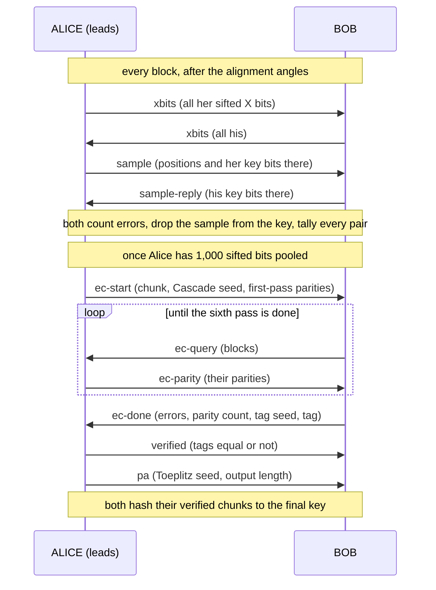

# MP-QKD after sifting: estimation, error correction, verification, privacy amplification

This note follows the sifted key of the MP-QKD showcase to the final secret key. After sifting, only
Alice and Bob talk, over the authenticated classical channel; Charlie takes no part. Alice leads:
she picks the error-estimation sample, starts error correction and sizes privacy amplification. The
stations run, in this order:

- **Parameter estimation**, every block (`[#5]`). E_X comes from all sifted X bits, E_Z from a 10 %
  sample of the key bits that then leaves the key, and both stations tally every pair's public
  class.
- **Error correction**, every chunk of 1,000 sifted bits (`[#6]`). Cascade, with every disclosed
  parity counted as leaked.
- **Verification**. A 32-bit universal-hash tag of each corrected chunk.
- **Privacy amplification**. A Toeplitz hash of the n corrected bits down to n q₁₁ [1 − h(e₁₁)]
  minus the leaked bits.

Two further sections cover the estimates behind that length: q₁₁ from the decoy bound, e₁₁ from the
honest-channel model, the rigorous e₁₁ bound and why it is unresolved, and the simplified
finite-key length reported next to the asymptotic one.

Three files hold the code. [`station.py`](station.py) sends and handles the messages,
[`postprocess.py`](postprocess.py) holds Cascade and the Toeplitz hash, and
[`keyrate.py`](keyrate.py) the decoy bounds, the channel model and the key length. `[#5]` and `[#6]`
are the `[CLASSICAL #N]` annotations of [`reference.py`](reference.py), which the README's
[Parties and the classical channel](../../README.md#parties-and-the-classical-channel) table maps
onto messages.



## The run quoted here

The numbers below come from one run at the showcase's default 100 km, and from in-process checks
named where they appear:

```bash
phoq run --protocol mpqkd --blocks 20 --seed 1
```

That is 20 blocks of 200,000 pulses: 4 × 10⁶ pulses, or 6.4 ms of the 625 MHz link. It runs in
about 7 s.
The command prints the three consoles. The read-outs (*final key bits*, *q_11 (decoy lower
bound)* and the rest) are what the stations `report()`. The lab shows them next to each laptop, and
`Experiment.run()` returns them as each worker's `result`:

```python
from phoq.parties import Experiment, load_protocol

if __name__ == "__main__":  # the parties start processes of their own
    mpqkd = load_protocol("mpqkd")
    alice, charlie, bob = Experiment(mpqkd.build(), mpqkd.PARTIES, seed=1).run(20)
    print(alice.result)
```

Which blocks form a chunk depends on when the messages arrive, so a rerun with the same seed may cut
its chunks differently. Seeds 2–4 were run the same way to show how far the numbers move.

## What sifting hands over

After the alignment angles (`[#4]`), each station holds, per block:

- **Key bits**, from the Z pairs in which both stations' bright pulse was μ. Alice maps (0, μ) to 0
  and (μ, 0) to 1, Bob the other way round, so a pair whose two bright pulses fell in different
  rounds gives both the same bit (`z_bit` in [`alice.py`](alice.py) and [`bob.py`](bob.py)).
- **X bits**, from the X pairs whose alignment angles matched. Each is the station's
  phase-difference bit; Bob flips his when Charlie's two clicks came from different detectors
  (`x_bit`).
- **The public record of every pair**: both stations' basis labels and intensity levels (`basis`),
  whether θ matched (`theta`), and the interval between the two paired clicks (`clicks`).

A key bit is wrong when both bright pulses fell in the same round. The other round then holds two
vacuum pulses, and its click came from the intensity modulator's extinction leakage or from a dark
count. So the extinction ratio sets E_Z. `theory()` at 100 km gives:

| IM extinction ratio | E_Z |
| --- | --- |
| 30 dB | 4.0 × 10⁻³ |
| 40 dB (default) | 4.04 × 10⁻⁴, or 4.02 × 10⁻⁴ without dark counts |
| 50 dB | 4.3 × 10⁻⁵ |
| 200 dB | 2.4 × 10⁻⁶, the dark counts alone |

That is close to 4 × 10^(−ER/10), with ER the extinction ratio in dB: two bright pulses in one round
click twice as often as one, and two vacuum pulses leak twice as much as one.

## Parameter estimation

**Messages.** Right after the alignment angles, `Station._align` sends:

- `xbits`, both ways: every sifted X bit. X pairs never become key, so all their bits can be
  disclosed. Each station marks the errors, `x_err = kx != x_partner`.
- `sample`, Alice to Bob: she picks each key bit with probability `sample_fraction` = 0.1 and sends
  the positions and her bits. Bob answers with `sample-reply`, his bits at those positions
  (`_reply_sample`).

`_finish` counts the sample's errors, takes the sample out of the key (`keep[pos] = False`), and
pools the remaining bits, with the block's sample size and error count, for error correction.

**The tally.** `Counts.add_block` adds the block's pairs to tables that both stations fill from the
same announcements, so both compute the same estimates:

| Table | What it counts, per class (A, B) of Alice's and Bob's pair |
| --- | --- |
| `z[A, B]` | Z-type pairs: one vacuum and one pulse of level A (Alice) and B (Bob); level 0 means two vacua |
| `x[A, B]` | X-type pairs: two equal pulses of level A and B; level 0 again means two vacua |
| `x_sifted[A, B]` | the X-type pairs whose alignment angles matched |
| `x_errors[A, B]` | the errors, from `xbits`, among the sifted pairs that are X for both |
| `interval_sum` | rear − front summed over the key pairs, for the phase-walk model |
| `linewidth`, `detuning` | the two lasers' linewidths and frequency offset: each station reads its own laser and sends the values in `basis` |

Pairs with two unequal bright pulses are in neither table. The key comes from `z[μ, μ]`; every other
class only feeds the decoy statistics.

**The error rates.** E_X(μμ) = `x_errors[μ, μ] / x_sifted[μ, μ]` is the error rate of the signal X
pairs over the run so far. It checks the e₁₁ model, below. A block's E_Z is its sample's error
fraction, and the read-out *E_Z (sample)* pools all the samples.

**In the run** a block looks like this (the X part elided):

```
block 8: 944 pairs (r_p 4.72e-03, Eq.4 4.72e-03) → 105 key Z pairs (12 disclosed, E_Z 0.000) · … · sifted +93 = 1,035 bits
```

105 key bits, of which 12 were disclosed without an error and 93 went to the pool, which then held
the 1,035 bits of chunk 0.
Over the 20 blocks Alice disclosed 259 of the 2,595 key bits (10.0 %), and none differed. A sample
this small cannot resolve an E_Z of 4 × 10⁻⁴, which predicts 0.1 errors in 259 bits. Cascade later
found one error in the 2,093 bits it corrected (*E_Z (corrected)*, 4.8 × 10⁻⁴). E_X(μμ) ended at
0.167, where the model expects 0.249: a weak coherent X pair errs about a quarter of the time even
with no phase walk.

## Error correction: Cascade

**When.** Alice starts a chunk in `_maybe_start_ec` once her pool holds `chunk_bits` = 1,000
sifted bits and no other chunk is being corrected. All the pooled blocks go in, so a chunk is a
little over 1,000 bits: 1,035 and 1,058 in the run.

**Block sizes.** The chunk's error rate comes from its blocks' samples, as the Laplace estimate
$`\hat E_Z = (\text{errors} + 1)/(\text{sample} + 2)`$. `block_sizes` turns it into Cascade's block
sizes for the six passes (`cascade_passes`):

```math
k_1 = \left\lceil 0.73/\hat E_Z \right\rceil,\qquad k_i = \min\!\left(2^{\,i-1}k_1,\ \lfloor n/2\rfloor\right),\qquad i = 1,\dots,6 .
```

The cap at half the chunk keeps at least two blocks per pass, since a single block spanning
everything could never separate two hidden errors. Each pass shuffles the chunk with its own
permutation, `np.random.default_rng([seed, pass])` (`permutations`), from a seed Alice draws and
sends.

**Messages.**

- `ec-start`, Alice to Bob: the chunk number and its blocks, the Cascade seed, $`\hat E_Z`$, and the
  parities of the first pass's top-level blocks (`CascadeReference.first_pass`).
- `ec-query`, Bob to Alice: the blocks whose parities Bob needs, each as (pass, lo, hi) in that
  pass's shuffled order.
- `ec-parity`, Alice to Bob: their parities (`CascadeReference.parities`).
- `ec-done`, Bob to Alice: how many bits he flipped, how many parities he received, and a
  verification tag (next section).

**Bob's side**, `CascadeCorrector`. `receive` stores Alice's parities and marks each block whose
parity differs from Bob's own as *active*. `_step` then binary-searches every active block at once.
It asks only for the left half's parity; the right half's is the parent's XOR the left's, which Bob
infers without asking. Each round trip takes every open search one level down, so they all share
one `ec-query`. A search that reaches a single bit flips it (`_flip`). The flip changes the parity
of the block holding that bit in every earlier pass, and a block that turns odd starts a new search:
that is the cascade. When no search is open, Bob asks for the next pass's top-level parities. After
the sixth pass he is done.

**The leak.** Every parity Alice sends, in `ec-start` and in `ec-parity`, is one leaked bit. Alice
counts them in `CascadeReference.parities`, Bob in `CascadeCorrector.receive`. Bob's count travels
in `ec-done`, and Alice prints `⚠ chunk …: leak accounting differs` if the two disagree. The
parities Bob infers cost nothing, since nothing new was disclosed. The console also prints
Cascade's efficiency, $`f = \text{leak}/\big(n\,h(E)\big)`$, with E the errors corrected per bit
and h the binary entropy.

**In the run**, from Alice's console:

```
chunk 0: reconciling 1,035 sifted bits of blocks 0–8 (Cascade, k₁ = 72 from E_Z ≈ 0.0102, 15 first parities)
chunk 0: 1,035 bits reconciled, 0 errors corrected (E_Z 0.00e+00), 36 parities leaked · 32-bit tag matches ✓
chunk 1: reconciling 1,058 sifted bits of blocks 9–17 (Cascade, k₁ = 99 from E_Z ≈ 0.0074, 11 first parities)
chunk 1: 1,058 bits reconciled, 1 errors corrected (E_Z 9.45e-04), 33 parities leaked (f = 2.87) · 32-bit tag matches ✓
```

Chunk 0's 96 sample bits held no error, so $`\hat E_Z`$ = 1/98 = 0.0102 and k₁ = 72. With nothing
to find, its leak is the top-level parities of the six passes, with block sizes 72, 144, 288, 517,
517 and 517: 15 + 8 + 4 + 3 + 3 + 3 = 36. Chunk 1's 33 are 26 top-level parities and 7 for the
binary search in the 99-bit block that held its one error. Seeds 2–4 leaked 27 to 39 parities per
chunk.

At this error rate the leak is almost all top-level parities, a fixed cost of
$`\sum_i \lceil n/k_i\rceil`$ per chunk. A hundred-odd sample bits cannot tell 4 × 10⁻⁴ from 1 %,
and the Laplace estimate leans toward 1 %, which makes k₁ small. In process, on 200 chunks of 1,035
bits at a true error rate of 4 × 10⁻⁴, the estimate of 1.02 % costs 38 parities per chunk, where the
true value would cost 21. The sample sets nothing else. The key length uses the counted leak, not
f h(E_Z), so the 10 % of the key bits that the sample takes buys only the block size and the
*E_Z (sample)* read-out.

At a bench's error rates the picture changes. Cascade alone (`cascade_in_process`), on 200 random
1,000-bit chunks per row with the true error rate handed to it, gives:

| Error rate | Mean leak [parities] | Mean f | Chunks left with an error |
| --- | --- | --- | --- |
| 0.05 % | 16 | 1.74 | 1 of 200 |
| 0.5 % | 57 | 1.33 | 3 of 200 |
| 1 % | 98 | 1.25 | 0 |
| 2 % | 172 | 1.22 | 0 |
| 5 % | 349 | 1.22 | 0 |

f averages over the chunks that held at least one error. The chunks left with an error after six
passes are what the verification tag is for.

**Against the literature.** Mueller et al. (2025) describe Cascade in their §2.2 as phoq runs it.
The first blocks are k₁ = 0.73/q̂ long and double on a new permutation each pass, and a binary
search discloses one parity per step, at most ⌈log₂ k₁⌉ of them (chunk 1's 7 are ⌈log₂ 99⌉). Every
search of a level shares one message, and corrected bits cascade back into earlier passes. Their
numbers come from a different variant, the efficient Cascade of Pacher et al. (2015), on 2¹⁶-bit
frames: f = 1.03–1.05 over 0.5–9 % QBER (read off their Fig. 3) with 400–700 messages per frame,
and f = 1.036 with 446 messages on their live system. phoq's original protocol on the same frames,
in process, with the true QBER handed to it:

| QBER | Frames | f | Messages per frame | Frames left with an error |
| --- | --- | --- | --- | --- |
| 1 % | 20 | 1.149 | 211 | 0 |
| 2 % | 20 | 1.172 | 200 | 0 |
| 4 % | 20 | 1.197 | 206 | 0 |
| 6 % | 10 | 1.215 | 190 | 0 |
| 8 % | 10 | 1.236 | 191 | 0 |

The messages are `ec-start`, `ec-done`, and an `ec-query` and `ec-parity` per round trip, which
carries every open search of every pass. So phoq leaks 10–20 % more than their Cascade, with about
half the messages. A wrong estimate affects the two in opposite ways. With a true 2 %, their f stays
below 1.1 while the estimate is off by less than 3 %, and their messages grow with an overestimate,
past 3,000 per frame. phoq's f is 1.10, 1.17, 1.38 and 1.92 for estimates of 1, 2, 4 and 8 %, while
its messages fall from 714 to 52: a smaller k₁ means more top-level parities and shorter searches.
Their system estimates each frame's QBER from the errors corrected in the frame before
(q̂ᵢ₊₁ = qᵢ, their §3.2) instead of disclosing a sample. The README's
[Checked against the literature](../../README.md#checked-against-the-literature) has the full
comparison.

## Verification

When Bob's Cascade ends, `_ec_continue` draws a fresh seed and computes
`verification_tag(key, seed, 32)`: a 32-bit Toeplitz hash (next section) of his corrected chunk,
packed into 4 bytes. `ec-done` carries the seed and the tag. Alice hashes her own chunk with the
same seed (`_ec_done`), compares, and answers with `verified`. Both then run `_chunk_verified`.
Equal tags put the chunk on the list for privacy amplification; different tags discard it on both
sides (`DIFFERS ✗ — chunk discarded`).

Toeplitz matrices with a uniformly random seed form a universal₂ family, so two different chunks
give equal tags with probability 2⁻³² ≈ 2.3 × 10⁻¹⁰ over the seed. The 32 tag bits count as leaked
too (*leak verify*), and privacy amplification subtracts them. In the run both tags matched, 64 tag
bits in all. `tests/test_phoq.py` checks that the tag tells a chunk before correction from Alice's,
and matches after.

At 1,000 bits per chunk the tag costs 3.2 % of the corrected bits. Mueller et al. (§3.3, Eq. 11)
cut that cost by verifying several reconciled frames under one tag; phoq does not.

## Privacy amplification

**How long.** After each verified chunk Alice runs `_maybe_pa`. It sizes the hash of every verified
chunk still waiting, with q₁₁ and e₁₁ from `estimate()` on everything tallied so far
(`final_length`):

```math
\ell = \Big\lfloor\, n\,q_{11}\big[1 - h(e_{11})\big] - \mathrm{leak}_\mathrm{EC} - \mathrm{leak}_\mathrm{verify} \Big\rfloor,\qquad
h(x) = -x\log_2 x - (1-x)\log_2(1-x),
```

where n is the chunks' corrected bits, leak_EC their Cascade parities and leak_verify 32 bits per
chunk. The product q₁₁[1 − h(e₁₁)] is the *secret fraction* the consoles print. If ℓ ≤ 0 the chunks
wait for more (`PA: no secret key yet …`).

**The message.** `pa` carries the chunk numbers, a fresh seed and ℓ. Bob recomputes ℓ from his own
tally (`_pa`) and warns if it differs from Alice's by more than 8 bits or 25 %, whichever is larger,
since his counts may lead by a block. Then he uses Alice's.

**The hash.** `toeplitz_hash(bits, seed, m)` draws n + m − 1 random bits r from the seed and
multiplies the key by the m × n Toeplitz matrix $`T_{ij} = r_{i-j+n-1}`$ over GF(2). The product is
a convolution of r with the key, computed with one FFT (`fftconvolve`, exact in float64 at these
sizes) and read mod 2. `tests/test_phoq.py` checks it against the explicit matrix product and checks
that it is linear. Both stations print the final key in hex, and the read-out *final key sha256* is
a fingerprint of all of it.

**In the run** (keys shortened):

```
PA: 1,035 corrected bits × secret fraction 0.577 (q₁₁ ≥ 0.587, e₁₁ 0.0016 [model]) − 68 leaked → 529 final bits · key cb79c989…
PA: 1,058 corrected bits × secret fraction 0.471 (q₁₁ ≥ 0.479, e₁₁ 0.0016 [model]) − 65 leaked → 433 final bits · key 712f6f4e…
```

1,035 × 0.577 − 68 = 529 and 1,058 × 0.471 − 65 = 433. That makes 962 final bits, the same on both
laptops (fingerprint `c75c3ad987e8e402`), or 2.4 × 10⁻⁴ bits per pulse. The 243 sifted bits of
blocks 18 and 19 were still waiting for a chunk when the run ended.

**Against the paper's rate.** Zeng et al.'s key rate is

```math
R = r_p\, r_s \left\{ q_{11}\big[1 - h(e_{11}^X)\big] - f\,h(E_Z) \right\}\quad\text{bits per pulse},
```

with r_p the pairs per pulse and r_s the share of pairs that are key pairs. ℓ applies the same
formula to the bits the stations hold, with the counted leak in place of f h(E_Z). The read-out
*rate, asymptotic formula* evaluates it over the whole run, as key pairs per pulse × 0.9 (the sample
is gone) × (secret fraction − leak_EC/n): 2.50 × 10⁻⁴ here. `theory()` gives 2.82 × 10⁻⁴ with the
model's single-photon-pair fraction, and 2.63 × 10⁻⁴ with the decoy bound's asymptotic value.

**What the leak costs.** The run leaked 69 Cascade parities and 64 tag bits on 2,093 corrected bits,
6.4 % of them. The paper's f h(E_Z), with `theory()`'s f = 1.16 and E_Z = 4.0 × 10⁻⁴, is 0.6 %. At
this error rate the cost is the chunks' overhead: Cascade's top-level parities, and a 32-bit tag per
1,000 bits.

## How q₁₁ and e₁₁ are estimated

Both stations call `estimate()` on their own tallies. These hold the same public numbers, so the two
estimates agree once both have tallied the same blocks; `pa` still carries Alice's ℓ.

### q₁₁ from the decoy bound

q₁₁ is the fraction of the key pairs in which Alice's pair and Bob's pair each carried exactly one
photon. A pair's photon number is Poissonian in its total intensity: one vacuum pulse and one at μ
make μ. `gains` divides each class's count by its prior probability. For a Z-type pair with no
bright pulse, one at ν or one at μ, `z_priors` gives s₀², 2s₀s_ν and 2s₀s_μ, with the level
probabilities s = 0.6, 0.15 and 0.25. That leaves the pair gains Q_AB up to a common factor, which
the bound does not need. `decoy_y11_lower` forms the vacuum + weak decoy lower bound on the
single-photon-pair yield, assuming only that every yield Y_nm ≥ 0:

```math
F(A,B) = e^{A+B}\,Q_{AB},\qquad G(A,B) = F(A,B) - F(A,0) - F(0,B) + F(0,0),
```

```math
Y_{11} \ge \frac{\mu^3 G(\nu,\nu) - \nu^3 G(\mu,\mu)}{\mu^2\nu^2(\mu - \nu)},\qquad
q_{11} \ge \frac{\left(\mu e^{-\mu}\right)^2 Y_{11}}{Q_{\mu\mu}} .
```

G removes every term in which one side sent no photon. In the numerator the three-photon terms
cancel and every higher one is negative, which is what makes it a lower bound. `q11_lower_from_z`
clips the result to [0, 1].

**In the run** the bound stood at 0.587 at the first privacy amplification (after 9 blocks), 0.479
at the second (after 19) and 0.469 at the end, on 64 (ν, ν) Z pairs. `theory()` gives 0.441 for the
model's single-photon-pair fraction and 0.412 for the bound's asymptotic value. Evaluated on a few
dozen decoy pairs, the "lower bound" landed above the fraction it bounds. Seeds 2–4 show the spread:

| Seed | (ν, ν) Z pairs after 20 blocks | q₁₁ bound at the two PA steps | Final key bits |
| --- | --- | --- | --- |
| 1 | 64 | 0.587, 0.479 | 962 |
| 2 | 62 | 0.479, 0.426 | 799 |
| 3 | 55 | 0.203, 0.298 | 399 |
| 4 | 49 | 0.406, 0.261 | 559 |

The sizing is asymptotic. Fluctuations like these are what a finite-key analysis has to absorb
([below](#asymptotic-and-finite-key-lengths)).

### e₁₁ from the honest-channel model, by default

e₁₁ is the phase-error rate of those single-photon pairs. With the default `estimator="model"`,
`estimate()` takes it from a model of the honest channel, as the paper's own simulation does:

1. **Transmittance.** `fit_transmittance` finds the arm transmittance η that reproduces Charlie's
   single-click probability per round, assuming a symmetric link.
2. **Phase walk.** The two lasers' phases walk apart between the two rounds of a pair.
   `misalignment` takes the linewidths Δν_A and Δν_B and the detuning Δf that the stations
   announced, and the key pairs' mean pairing interval τ:

   ```math
   e_d = \tfrac12\left[1 - e^{-\sigma^2/2}\cos(2\pi\,\Delta f\,\tau)\right],\qquad \sigma^2 = 2\pi(\Delta\nu_A + \Delta\nu_B)\,\tau .
   ```

3. **The single-photon pair**, the paper's Eq. (D15) (`e11_model`), with p_d the dark-count
   probability per bin and e₀ = 1/2:

   ```math
   Y_{11} = (1-p_d)^2\left[\frac{\eta_A\eta_B}{2} + (2\eta_A + 2\eta_B - 3\eta_A\eta_B)\,p_d + 4(1-\eta_A)(1-\eta_B)\,p_d^2\right],
   ```

   ```math
   e_{11}Y_{11} = e_0Y_{11} - (e_0 - e_d)\,(1 - p_d^2)\,\frac{\eta_A\eta_B}{2} .
   ```

4. **A check against E_X.** `x_error_model` predicts the E_X of the sifted (μ, μ) X pairs from the
   same η and e_d. If the measured E_X(μμ) lies more than 2σ above it, `estimate()` raises e_d until
   the model reaches E_X − 2σ, and recomputes e₁₁. A measured E_X below the model changes nothing,
   so the check can only make e₁₁ worse.

**In the run** e₁₁ = 0.00156, as `theory()` has it. With dark counts this rare, e₁₁ is essentially
e_d.
Charlie's clicks come every 1/0.0096 ≈ 100 rounds, so τ is about 170 ns, and the relative phase of
two 3 kHz lasers spreads by σ² ≈ 6 × 10⁻³ rad² in that time. E_X(μμ) measured 0.167 against the
model's 0.249, so e_d stayed as it was.

### The rigorous e₁₁ bound, and why it is unresolved

The rigorous route bounds the error gain of the single-photon pairs from the X-type classes, whose
totals are 2ν and 2μ (`decoy_ey11_upper`):

```math
(eY)_{11} \le \frac{H(\nu',\nu') - H(\nu',0) - H(0,\nu') + H(0,0)}{\nu'^2},\qquad H(A,B) = e^{A+B}E_{AB}Q_{AB},\qquad \nu' = 2\nu .
```

A class with a vacuum side has E = 1/2 by construction and needs no disclosed bits. Then
$`e_{11} = (eY)_{11}/(s\,Y_{11})`$, capped at 1/2, with Y₁₁ the same two-decoy bound applied to the
X-type classes and s the share of X-type pairs whose alignment angles match. `estimate()` reports it
as unresolved (NaN) while that Y₁₁ bound is not positive, or while fewer than 100 sifted (ν, ν) X
pairs (`MIN_DECOY_X_PAIRS`) are in.

It stays unresolved here for the two reasons that [`keyrate.py`](keyrate.py)'s docstring gives.
In-process checks on expectation values (`expected_counts`) put numbers on both:

- **Statistics.** The numerator is a difference of error gains of the weakest decoy class, which has
  to be known to about 1 %. 10⁹ pairs hold 48,662 sifted (ν, ν) X pairs. The run's 19,221 pairs hold
  about one, and the threshold of 100 needs about 2 × 10⁶ pairs, or 4 × 10⁸ pulses.
- **The X intensities.** At 2ν = 0.2 and 2μ = 0.8 the multiphoton correction ν'³G(μ', μ') is 5 %
  larger than the term it corrects, μ'³G(ν', ν'). So the Y₁₁ bound is negative, and more data does
  not change that: 10¹² pairs give the same ratio. A rigorous e₁₁ needs a weaker pair of X
  intensities as well as the statistics.

`MPQKDParams(estimator="decoy")` sizes privacy amplification with this bound instead. It takes
e₁₁ = 1/2 while the bound is unresolved, so the secret fraction is 0 and the stations distill no
key.

## Asymptotic and finite-key lengths

`final_length`, which sizes every privacy amplification, is asymptotic: it treats q₁₁ and e₁₁ as
exact. Next to it the read-outs report `finite_key_length`, as *finite-key bits (simplified
estimate, ε=1e-10)*. It is computed over all the corrected bits so far and never sizes the hash. Its
docstring calls it "clearly not the paper's full analysis". With ε = `eps` = 10⁻¹⁰ and
$`\delta(m) = \sqrt{2m\ln(1/\varepsilon)} + \ln(1/\varepsilon)`$, it:

- shifts the Z-type counts by Chernoff-style deviations: the (ν, ν) count down by δ, the (μ, μ)
  count up by δ, and every entry of the vacuum row and column up by a third of δ of their sum, then
  recomputes q₁₁;
- adds a Hoeffding term $`\sqrt{\ln(1/\varepsilon)/2n_X}`$ to e₁₁, with n_X the sifted (μ, μ) X
  pairs;
- subtracts 2 log₂(1/ε) + log₂(2/ε) = 101 bits for verification and privacy amplification.

```math
\ell_\varepsilon = \Big\lfloor n\,q_{11}^{\varepsilon}\Big[1 - h\Big(e_{11} + \sqrt{\ln(1/\varepsilon)/2n_X}\Big)\Big] - \mathrm{leak}_\mathrm{EC} - \mathrm{leak}_\mathrm{verify} - 2\log_2\tfrac{1}{\varepsilon} - \log_2\tfrac{2}{\varepsilon}\Big\rfloor
```

where q₁₁^ε is the bound on the moved counts and e₁₁ is capped at 1/2.

**In the run** ℓ_ε = 0, as it is for seeds 2–4. δ for the run's 64 (ν, ν) Z pairs is 77, more than
the count itself, so q₁₁^ε = 0. The Hoeffding term would add 0.32 to e₁₁ on top: 4 × 10⁶ pulses are
expected to hold about 110 sifted (μ, μ) X pairs. On expectation values, at the run's leak per
corrected bit, ℓ_ε turns positive between 3 × 10⁷ and 4 × 10⁷ pulses (150 to 200 blocks), and then
closes on the asymptotic length:

| Pulses | Link time at 625 MHz | ℓ_ε / ℓ |
| --- | --- | --- |
| 4 × 10⁶ (this run) | 6.4 ms | 0 |
| 4 × 10⁷ | 64 ms | 0.03 |
| 10⁸ | 0.16 s | 0.28 |
| 10⁹ | 1.6 s | 0.71 |
| 10¹⁰ | 16 s | 0.90 |
| 10¹¹ | 160 s | 0.97 |

**Not modeled:** the cost of authentication. The classical channel is authenticated with HMAC and a
pre-shared key (see the README), so it costs no key bits here; information-theoretic authentication
would spend part of the key on it.

## Where each step lives

| Step | Messages | Code |
| --- | --- | --- |
| E_X | `xbits` | `Station._align`, `_finish`; `Counts.add_block` |
| E_Z sample | `sample`, `sample-reply` | `Station._align`, `_reply_sample`, `_finish` |
| Decoy tally | none: `basis`, `theta` and `clicks` carry it | `Counts.add_block` |
| Cascade | `ec-start`, `ec-query`, `ec-parity` | `_maybe_start_ec`, `_ec_start`, `_ec_query`, `_ec_parity`; `block_sizes`, `permutations`, `CascadeReference`, `CascadeCorrector` |
| Verification | `ec-done`, `verified` | `_ec_continue`, `_ec_done`, `_chunk_verified`; `verification_tag` |
| q₁₁ and e₁₁ | none | `estimate`, `gains`, `q11_lower_from_z`, `decoy_y11_lower`, `decoy_ey11_upper`, `fit_transmittance`, `misalignment`, `e11_model`, `x_error_model` |
| Privacy amplification | `pa` | `_maybe_pa`, `_pa`, `_amplify`; `final_length`, `toeplitz_hash` |
| Finite-key length, reported only | none | `finite_key_length`, called in `_readouts` |

## References

- P. Zeng, H. Zhou, W. Wu and X. Ma, "Mode-pairing quantum key distribution", Nat. Commun. 13, 3903
  (2022): the key rate (Eq. 7), the decoy bounds (Appendix C) and the simulation formulas
  (Appendix D, Eqs. D1–D15).
- G. Brassard and L. Salvail, "Secret-key reconciliation by public discussion", Advances in
  Cryptology — EUROCRYPT '93, LNCS 765 (Springer, 1994): Cascade and k₁ ≈ 0.73/QBER.
- R. Mueller, C. De Lazzari, F. Chirici, I. Vagniluca, L. K. Oxenløwe, S. Forchhammer, A. Zavatta
  and D. Bacco, "Performance of Cascade and LDPC codes for information reconciliation on industrial
  quantum key distribution systems", IET Quantum Commun. 6, e70003 (2025),
  [doi:10.1049/qtc2.70003](https://doi.org/10.1049/qtc2.70003): Cascade's steps (§2.2), its
  efficiency and messages on 2¹⁶-bit frames (Fig. 3, §3.1, §3.4), wrong QBER estimates (§3.2) and
  the cost of verification (§3.3).
- C. Pacher, P. Grabenweger, J. Martinez-Mateo and V. Martin, "An information reconciliation
  protocol for secret-key agreement with small leakage", IEEE ISIT 2015, pp. 730–734: the efficient
  Cascade that Mueller et al. simulate (cited from their reference list, not checked here).
- X. Ma, C.-H. F. Fung and M. Razavi, "Statistical fluctuation analysis for
  measurement-device-independent quantum key distribution", Phys. Rev. A 86, 052305 (2012),
  arXiv:1210.3929: the single-photon-pair yield and phase-error rate of MDI-QKD with weak coherent
  pulses, which `keyrate.py` credits for Eq. (D15).
